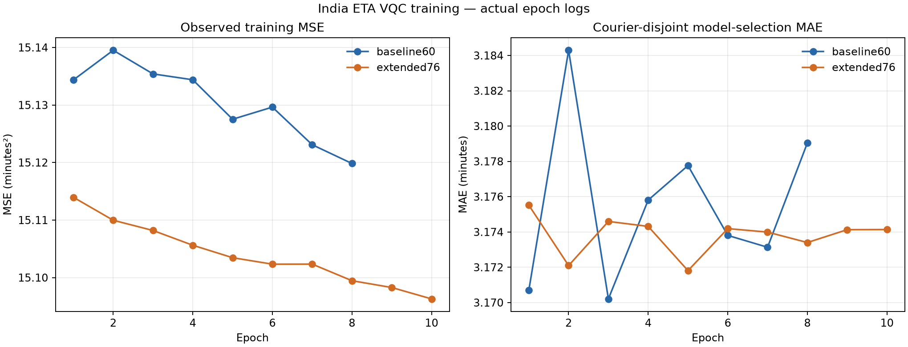

# RUN2 India ETA: Four-Qubit Residual VQC Training and Release

**Status:** training and CPU release complete; operational policy remains the frozen GBDT-only fallback (`alpha=0`). The two VQC candidates are preserved for research comparison. The one new 4Q score is a **retrospective evaluation**, not a pristine test result.

## Result

The task trained two four-qubit residual regressors against the frozen HistGradientBoosting ETA model: a 60-angle circuit and a 76-angle extension. Both checkpoints reproduced bit-for-bit in a separate resource-instrumented run. Independent statevector, Jacobian, Torch reload, and local QpiAI checks passed. The portable CPU bundle includes the GBDT, both candidate checkpoints, the Ridge control, preprocessing constants, feature schema, fusion policy, and synthetic reference cases.

Validation model selection froze `alpha=0` because neither VQC passed the predeclared gate against both GBDT and Ridge on **both** MAE and RMSE. The 76-angle candidate looks better on MAE and RMSE in this retrospective test score, but that result did not change the policy. The original test partition was previously scored by an earlier two-qubit workflow, so it cannot support a fresh-holdout claim.

## Scope and data contract

This is a whole-delivery ETA residual regression task. It is **not** a completed VQC-to-QUBO dispatch algorithm, route optimizer, or road-arc travel-time model.

The frozen GBDT predicts `delivery_duration_min` in minutes from 59 prepared numeric features. The quantum candidates predict a minute-valued residual:

`residual = observed_duration_min - train_OOF_GBDT_prediction_min`

The residual scale was the train-OOF population standard deviation, `3.889107305742781` minutes. Each VQC receives the four already-prepared inputs in `[0,1]`, in this order: `vqc_x0_distance`, `vqc_x1_congestion`, `vqc_x2_multidelivery`, `vqc_x3_preptime`. IDs, courier IDs, split labels, the target, and synthetic SLA fields are not model inputs. Row joins use delivery record ID, courier ID, and split.

The input schema's raw-feature availability remains a product limitation. In particular, `order_to_pickup_min_imp` is only available after pickup, and the dataset does not establish timestamps for every weather, traffic, courier-rating, and workload field. See the [feature availability audit](docs/INDIA_ETA_FEATURE_AVAILABILITY_AUDIT.md). The release accepts the prepared 59-feature matrix; it does not contain raw-record feature engineering.

Training used 29,592 courier-grouped OOF rows. The validation groups were frozen as 117 model-selection couriers / 4,124 rows and 58 fusion-calibration couriers / 1,865 rows. Architecture selection and early stopping used the model-selection groups; calibration metrics were recorded only after checkpoint choice. The 5,941-row original test split has 176 courier groups.

## Circuit and numerical evidence

Both models use four qubits and five data-upload blocks. Each block re-encodes all four prepared features with `RY(pi*x)`, then applies trainable RX, RY, and RZ rotations with forward and reverse CNOT rings. A fixed noncommuting readout basis removes the final bare-Z gauge. The extended circuit adds 16 independent RX angles after the first four blocks. Its zero-extension exactly reproduces the 60-angle circuit before those weights are trained.

| Candidate | Trainable quantum angles | Readout weights and bias | Total learned parameters | Logical gates | Ordered dependency depth (derived) |
|---|---:|---:|---:|---:|---:|
| `baseline60` | 60 | 5 | 65 | 128 | 62 |
| `extended76` | 76 | 5 | 81 | 144 | 66 |

Dependency depth counts the four CNOTs in each ring in their actual order, with no reordering: 12 layers per block, plus two fixed readout-basis layers; the extension adds one layer to each of its first four blocks. This is a logical critical-path count from the circuit sequence, not a compiler/transpiler or hardware-depth measurement.

The independent dense 16×16 matrix oracle matched both NumPy statevectors and Z expectations to below `2e-12`; observed amplitude errors were `4.44e-16` (`baseline60`) and `3.07e-16` (`extended76`), with state-norm error at most `1.45e-15`. Exact zero-extension prediction equality passed. On 64 train-OOF feature rows, the finite-difference observable Jacobian had local rank 60/60 and 76/76 at zero extension, adding all 16 independent local directions. The same check on fitted weights remained rank 60/76; the smallest projected extension direction was about `1.019` in L2 norm. These are local Jacobian results on the stated inputs, not claims of global parameter identifiability.

The circuit suite checks finite-difference gradients for both Torch variants, checkpoint transfer, zero-extension equality, and actual local QpiAI `StatevectorSimulator` execution. On eight validation feature rows with the **fitted** weights, QpiAI/NumPy Z expectation error was at most `6.67e-16`; minute residual error was at most `2.78e-16`. Re-loaded Torch CPU residual predictions differed from NumPy by at most `3.56e-7` minutes. This used a local exact simulator only; no cloud service or QPU was used.

## Training and compute

Training ran on CPU in 8 threads using Python 3.12.10 and Torch 2.14.1+cu130. The RTX 5060 Laptop GPU was visible, but the run selected CPU after a small matched synthetic profile measured CPU at `16.90 ms/update` and CUDA at `56.19 ms/update` (three timed updates after warm-up). That microprofile is not production throughput evidence.

| Stage | Epochs completed | Best model-selection epoch | Optimizer updates | Sum of logged epoch time |
|---|---:|---:|---:|---:|
| `baseline60` | 8 | 3 | 1,856 | 30.11 s |
| `extended76` | 10 | 5 | 2,320 | 46.49 s |
| **Total** | 18 | — | **4,176** | **76.61 s** |

The original run recorded 76.85 seconds wall time but not process CPU time or peak memory. It ran 2026-10-29 20:10:56–20:12:13 IST (14:40:56–14:42:13 UTC). A separate, deterministic resource reproduction ran 20:18:14–20:19:53 IST (14:48:14–14:49:53 UTC), completed in 77.106 seconds wall time, used 615.078 CPU seconds across eight threads, and peaked at 860,368,896 bytes Windows working set. It reproduced both frozen checkpoints bit-for-bit and used no calibration or test data. It measured 4,194 forward calls over 606,888 input rows / 9,710,208 statevector amplitude elements. Extension-angle gradient L2 over updates ranged from `0.0700` to `0.6376` (mean `0.2412`). The angles start at zero, but their gradients do not: first-step gradient L2 was `0.163355`, and the minimum over updates was `0.070011`.

The plotted curves below use the actual per-epoch JSONL log. The training loss logged is MSE in minutes²; the validation curve is model-selection MAE in minutes.



## Validation results and frozen policy

All metrics are minutes. Selection values below were independently recomputed from saved predictions and frozen checkpoints. Calibration rows were evaluated after the selection choice and were not used to choose the operational alpha.

| Model | Selection MAE | Selection RMSE | Selection median abs. error | Calibration MAE | Calibration RMSE | Calibration median abs. error |
|---|---:|---:|---:|---:|---:|---:|
| Frozen GBDT | 3.172583 | 3.932094 | 2.793923 | 3.077069 | 3.847571 | 2.643647 |
| GBDT + Ridge control | 3.172207 | 3.931903 | 2.796163 | 3.077200 | 3.847371 | 2.654300 |
| GBDT + `baseline60` | 3.170207 | 3.932810 | 2.779078 | 3.076437 | 3.849747 | 2.653338 |
| GBDT + `extended76` | 3.171809 | 3.933179 | 2.759695 | 3.078507 | 3.846651 | 2.666931 |

The frozen deployment gate required a candidate to improve MAE strictly and remain no worse in RMSE than **both** GBDT and Ridge on the model-selection couriers. `baseline60` improved MAE but had higher RMSE than both references; `extended76` also had higher RMSE. Therefore the policy is **alpha=0, GBDT only**, and operational predictions match the baseline exactly. The policy and model weights were frozen before the 4Q test evaluation.

## Retrospective test evaluation

The current 4Q evaluation used one batch per method on the same 5,941 test IDs, sorted by delivery record ID. No checkpoint, architecture, or policy was selected from these values.

| Method | MAE | RMSE | Median absolute error |
|---|---:|---:|---:|
| Frozen GBDT | 3.146740 | 3.968180 | 2.686081 |
| GBDT + Ridge control | 3.146675 | 3.968316 | 2.688623 |
| GBDT + `baseline60` candidate | 3.147268 | 3.969599 | 2.703858 |
| GBDT + `extended76` candidate | 3.144121 | 3.967810 | 2.689587 |
| Frozen operational alpha=0 | 3.146740 | 3.968180 | 2.686081 |

The `extended76` diagnostic candidate has lower retrospective MAE and RMSE than GBDT, but it was not deployed: the validation-only policy had already frozen alpha=0, and this partition was exposed in earlier work. The operational output remains the GBDT prediction.

**Test exposure and decoder limitation:** the original test split was already opened and scored by a prior RUN2 two-qubit workflow, so it is not untouched. Before this 4Q score, a feature-only acceptance check called the pandas/fastparquet row filter and materialized test feature columns because that filter was ignored; no target or synthetic label columns were requested, and those features were not used for selection or metrics. The final scorer then encountered the same storage limitation: the GBDT Parquet file is one mixed-split row group, and fastparquet materialized all 41,522 selected rows/columns despite the test filter. The scorer immediately retained the 5,941 `split_partition == test` records; only those targets and predictions entered the metrics. The 35,581 non-test target values were materialized during decoding and discarded without scoring. This is reported explicitly and further disqualifies a pristine-holdout interpretation.

The one-shot scorer wrote [test metrics](artifacts/india_eta_vqc4_run2/retrospective_test_metrics.json) and a keyed [row-prediction table](artifacts/india_eta_vqc4_run2/retrospective_test_predictions.parquet). Its status record says the policy did not change.

### One-batch CPU inference timings

| Pipeline | Elapsed inference (seconds) | VQC residual call |
|---|---:|---:|
| GBDT only | 0.011717 | 0 |
| GBDT + Ridge | 0.012109 | 0 |
| GBDT + `baseline60` | 0.079782 | 1 batch of 5,941 |
| GBDT + `extended76` | 0.090345 | 1 batch of 5,941 |
| Operational alpha=0 | 0.011717 | 0 |

Timings exclude input parsing and metrics. Hybrid totals include shared feature mapping and GBDT inference; the separate VQC residual forward calls took `0.067975 s` and `0.078538 s`. These are single-call measurements on the current CPU, not a repeated benchmark. The evaluator's operational alpha=0 pathway uses the GBDT baseline directly and makes no VQC call. The portable bundle's general `predict()` API is diagnostic: it returns all five model/policy columns and computes both VQC candidates even when the frozen operational policy is alpha=0. The single-batch operational timing above measures the GBDT pathway, not a full diagnostic `predict()` call.

## Portable release

The standalone CPU bundle is [india_eta_vqc4_cpu_release_v1.zip](artifacts/run2_india/india_eta_vqc4_cpu_release_v1.zip), SHA-256:

`18d5d4859e53d3d59063e60cdcdd45cb6eff6757bba6474f024cdde91aa06b80`

The archive contains 13 safe basenames: the hash-pinned HGB checkpoint, both JSON VQC checkpoints, Ridge control, ordered feature schema, preprocessing/scaling constants, circuit implementation, fusion policy, loader, dependency pins, README, and three-row synthetic reference fixture. It contains no raw dataset, OOF table, validation table, or test predictions. The loader verifies the pinned manifest and every inventoried artifact before deserializing joblib. It runs on CPU with NumPy 1.26.4, scikit-learn 1.4.2, and joblib 1.6.0; Torch, QpiAI, cloud access, and a QPU are not required.

Directory execution, repeated ordinary imports after `__pycache__` creation, isolated ZIP extraction/reload, exact inventory checks, synthetic prediction parity, bool/object input rejection, extra-file rejection, and model tamper rejection before deserialization passed. ZIP contents are unchanged by testing. The final test output parquet is outside the release bundle.

## Frozen artifacts and hashes

| Artifact | SHA-256 |
|---|---|
| Circuit source | `801468f544e25ae913c26e1f2131cf5f88b384b8495172da62be9051d5a96ba0` |
| Trainer source | `88e0506c94d86c6650270599f4133488b6e2c5059a307bd34859a2c0aee56154` |
| `baseline60` checkpoint | `6a6458d42ac9561845bd606543f9017f997a01ae31b4afa75a4f554d0d30cffe` |
| `extended76` checkpoint | `002626418344b9650a24da3ca02309acc743d9fc57a166899941c1f0d216ec14` |
| Frozen training run manifest | `d12f2ba6f62b1bc760954e7e6de60f1027a871f3ef234768b36c571426e000f3` |
| Independent development acceptance | `d24be325f30c9ff2689917cfb7c6d39c0920621e94280b7234ca699334ebfc7a` |
| Resource reproduction metrics | `d4b040187601229b9c472a0fbe990613b79242d6781959964297ea01ca0bd2bd` |
| Runtime/provenance record | `3b284f63a400368ad0a40860a6837456bec38a6e06df744a35aee1460ff49080` |
| Pretest freeze | `6dd053da6e85d8afa04de023a6695a5f9ad37bd6614b63b5edb4d0a38a40b5a3` |
| Test metrics | `4df304c84d9b6c44448204f9324d433fa6f283f28b1701695e9455c1e1dc4579` |
| Test row predictions | `b7a5e2794057ec8ff1769ab51f174bcc6c9ffc76520bc916a2bf4c0c4821c139` |

See the [independent frozen-weight audit](artifacts/india_eta_vqc4_run2/independent_frozen_acceptance.json), [numerical circuit acceptance](experiments_india_vqc4/independent_numerical_acceptance.json), [pretest freeze](artifacts/india_eta_vqc4_run2/PRETEST_FREEZE.json), and [runtime/provenance record](artifacts/india_eta_vqc4_run2/runtime_status.json) for detail.

The archived original training implementation is [`.runtime/run2/repro_original/train.py`](.runtime/run2/repro_original/train.py); the active trainer is [`experiments_india_vqc4/train.py`](experiments_india_vqc4/train.py). The runtime record gives exact session timestamps, commands, and source/checkpoint hashes.

## Reproduction and verification commands

## Artifact index and completion scope

Key artifacts are linked here for review:

- Frozen VQC weights: [`baseline60_best.json`](artifacts/india_eta_vqc4_run2/baseline60_best.json), [`extended76_best.json`](artifacts/india_eta_vqc4_run2/extended76_best.json).
- Frozen classical baseline and train-only OOF: [`india_eta_hgb_regressor.joblib`](artifacts/india_eta_recovery/gbdt/india_eta_hgb_regressor.joblib), [`oof_predictions.parquet`](artifacts/india_eta_recovery/oof_predictions.parquet), [`oof_fold_manifest.json`](artifacts/india_eta_recovery/oof_fold_manifest.json).
- Ordered feature and preprocessing contracts: [`feature_schema.json`](artifacts/india_eta_recovery/gbdt/feature_schema.json), [`preprocessing_artifacts.json`](artifacts/india_eta_recovery/gbdt/preprocessing_artifacts.json); split and role contracts: [`recovery_manifest.json`](artifacts/india_eta_recovery/recovery_manifest.json), [`validation_role_assignment.json`](artifacts/india_eta_recovery/validation_role_assignment.json), and the VQC [`run_manifest.json`](artifacts/india_eta_vqc4_run2/run_manifest.json).
- Training evidence: [`training_progress.jsonl`](artifacts/india_eta_vqc4_run2/training_progress.jsonl), [`training_curves.csv`](artifacts/india_eta_vqc4_run2/training_curves.csv), [`training_curves.png`](artifacts/india_eta_vqc4_run2/training_curves.png).
- Portable archive contents and hashes: [`release_manifest.json`](artifacts/run2_india/india_eta_vqc4_cpu_release_v1/release_manifest.json) and the [release ZIP](artifacts/run2_india/india_eta_vqc4_cpu_release_v1.zip).

Completion status:

- **Completed:** training both candidate circuits, exact checkpoint reproduction, numerical/statevector checks, local SDK parity, frozen-weight reload checks, and CPU release construction/verification.
- **Acceptance gate not met:** neither VQC satisfied the predeclared validation improvement gate against both classical references, so the frozen operational policy remains GBDT-only (`alpha=0`).
- **Unavailable:** a pristine held-out evaluation is unavailable because this test partition was previously exposed by an earlier workflow. The reported 4Q test metrics are retrospective and were not used for selection.
- **Not run / out of scope:** cloud execution and QPU evaluation were not run; this release is an ETA residual regression package, not a routing VQC-to-QUBO dispatch algorithm.

Frozen training command (recorded by the worker):

```powershell
$env:PYTHONPATH=(Resolve-Path '.runtime\run2\cuda-site').Path
.runtime\run2\venv\Scripts\python.exe -u -m experiments_india_vqc4.train --device cpu --batch-size 128 --epochs60 30 --epochs76 25 --patience 5 --lr60 0.01 --lr76 0.002
```

Independent frozen-model, dev-only verification:

```powershell
$env:PYTHONDONTWRITEBYTECODE='1'
$env:PYTHONPATH='.runtime\run2\cuda-site;.runtime\run2\site-packages;.'
& '..\silver-computing-machine\.venv\Scripts\python.exe' -m experiments_india_vqc4.independent_frozen_acceptance
```

Portable reference check:

```powershell
.runtime\run2\venv\Scripts\python.exe artifacts\run2_india\india_eta_vqc4_cpu_release_v1\predictor.py --verify-reference
```

Circuit/reference and release tests:

```powershell
$env:PYTHONDONTWRITEBYTECODE='1'
$env:PYTHONPATH='C:\Users\avkir\Downloads\sports_prediction_model-main\sports_prediction_model-main\venv\Lib\site-packages;.runtime\run2\site-packages;.'
& '..\silver-computing-machine\.venv\Scripts\python.exe' -m pytest tests/test_india_vqc4_circuit.py tests/test_india_vqc4_independent_acceptance.py tests/test_india_vqc4_portable_release.py -q -rs
```

The combined circuit/reference tests passed 10/10; the portable release tests passed 4/4. The only warnings were pandas/fastparquet deprecations and a harmless non-writable NumPy-to-Torch validation-fixture warning. The one-shot test evaluation command was:

```powershell
$env:PYTHONDONTWRITEBYTECODE='1'
$env:PYTHONPATH='.'
.runtime\run2\venv\Scripts\python.exe -u -m experiments_india_vqc4.evaluate_retrospective_test
```

That command now refuses to run again because the start/completion sentinels are present.
