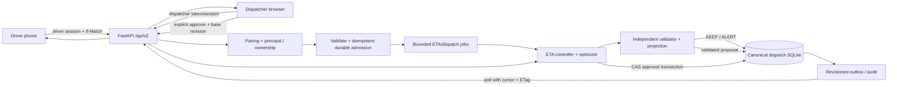

# DEBUGLEAF — Backend and Quantum Architecture Review

**Status:** decision-ready architecture and worker handoff; all `/api/v2` contracts below are proposals, not implemented APIs. **Audit date:** 2026-10-30 Asia/Calcutta. **Repository:** `silver-computing-machine/` at main HEAD `2c7a4fb809c58a9ec02b6cf2d7b9a8a8bacb1c95`; main was clean before review. `trainingv3/` at `12ea0ac10964b0e2233e28ae493beab7bb3d4848` / `feature/india-vqc4-run2` was preserved. No repository implementation source, model weights, or training worktree state was changed during the review; the documentation artifacts were mirrored into this repository later under owner authorization for delivery. Model and quantum inference were not deserialized/run in this audit. No paid cloud or QPU job was submitted.

## A. Executive decision

Build one bounded local P0 backend around the existing ETA controller/store, independent validation, durable jobs, and explicit dispatcher approval. Extend the configured ETA SQLite database with namespaced `dispatch_*` tables accessed through `EtaStore` transaction methods. Make `EtaController`/`EtaStore` the only authority for active plan versions, vehicle assignments and manifests. Reuse the existing route candidate, projection and validation functions; constrain the demo coordinator to synthetic candidate generation and remove its direct route publication path. Expose a new authenticated `/api/v2/dispatch/*` contract for driver pairing, events, proposals, approval and polling. Preserve `/api/v1` semantics.

Add `/api/v2/eta/predictions` as a research/development-only prepared-feature interface for the 59-feature RUN2 HGBR. The published CPU ZIP is hash-verified, but the unpacked source directory has a circuit hash mismatch and the project runtime is missing pinned dependencies. Deployment readiness therefore remains **NOT READY** pending a fresh trusted extraction, exact dependency runtime, loader integrity checks and reference parity. Frozen alpha remains zero: HGBR only; VQC comparisons are diagnostics and cannot drive routing. `delivery_duration_min` is a dataset whole-delivery label whose exact event boundaries are not independently proven; never pass it off as a road edge or route leg.

Keep dispatch optimization classical-first. Existing bounded local statevector/QUBO/QAOA and QpiAI local SDK adapters are research/evaluation paths. A QpiAI Opt model compile or QpiAI Quantum local simulator is not a hosted Opt solve, QCloud job or QPU run. No quantum advantage is supported. Pre-pickup predictions require a separate model restricted to time-available features.

Build order: (1) release/runtime preflight and API/dispatch contracts; (2) single-store proposal→independent validation→explicit approval transaction; (3) driver-scoped pairing and revisioned poll/sync; (4) bounded failure/restart/security checks; (5) deterministic local rehearsal; (6) only then optional refinements. Do not add distributed infrastructure, retrain India VQC, turn on automatic route publication, or advertise live fleet operations for this P0.

## B. Evidence inventory, source ledger, capability matrix

### Evidence rules and reviewed inputs

Classifications in the table are exact: **Verified implemented**, **Implemented but missing runtime verification**, **Partially implemented**, **Planned only**, **Absent**, **Blocked by external resources**. Source inspection is not execution. The main report, model sub-review and quantum sub-review distinguish historical test evidence from commands executed in this audit.

### Capability matrix

Each row uses exactly one status from the six required categories. Historical verification is identified in the evidence cell; it does not imply this audit reran it.

| Capability | Classification | Evidence and boundary |
|---|---|---|
| Static scenario validation, bounded exact route solving and independent static plan validation | Verified implemented | `backend/domain.py`, `backend/validator.py`; synthetic/static time units, no dispatch state/version/auth. |
| ETA plan registration, event evaluation, proposal, guarded approval CAS, manifests, SQLite history and bounded durable jobs | Implemented but missing runtime verification | `backend/india_eta/{controller,store,jobs,api}.py`; focused audit test attempts are partial (section L). |
| Two-feature linear JSON ETA fixture with release hash, as-of checks and target `travel_time` | Verified implemented | `backend/india_eta/prediction.py`; stays v1 and cannot stand in for the 59-feature model. |
| RUN2 CPU predictor, HGBR and research VQC checkpoints in the published archive | Implemented but missing runtime verification | Published ZIP hash and all 11 files match; this checkout’s unpacked directory differs at `circuit.py`; current Python environment misses/violates pins; no model was deserialized. |
| Synthetic demo road catalog and GeoJSON | Verified implemented | `backend/demo/routes.py`; fixed illustrative map, durations seconds and distance metres. |
| Demo coordination and same-vehicle auto-publication | Partially implemented | `backend/demo/service.py`; scoring/KEEP/proposal code exists, but direct publication bypasses validator and canonical ETA store; base route version is unused. |
| Pairing/session primitives | Partially implemented | `backend/demo/auth.py`, `backend/demo/store.py`; not HTTP-integrated, pair-code expiry and hash-at-rest token protections are missing, and ownership is not enforced at a route boundary. |
| Demo persistence | Partially implemented | Separate `demo_store.sqlite3`; publication, reports, jobs and audit are multiple commits with separate version counters. |
| QUBO construction, custom statevector QAOA, warm-start circuit, validator and exact classical fallback | Verified implemented | Local source and focused checks; current QUBO does not encode all business constraints, so validation remains mandatory. |
| QpiAI Opt model build/compile and QpiAI Quantum local simulator adapters | Implemented but missing runtime verification | Prior local compile/parity evidence exists; QUBO focused tests passed in the separate review; no hosted solve is represented. |
| Demo/driver HTTP dispatch API, scoped mobile sessions, poll/cursor feed and synced frontend | Absent | No `backend/demo` router or corresponding frontend API methods. |
| Prepared-feature model v2 endpoint, production 59-feature raw preparation, calibrated uncertainty, live position ingestion | Absent | Proposed only; feature timestamps are incomplete and several inputs are known only after pickup; current actual-position route returns 501. |
| Shared-store dispatch tables/outbox, scoped driver auth and v2 contracts | Planned only | Specified in C–H; no implementation claim. |
| Authenticated QpiAI Opt hosted solve, authenticated QCloud execution, actual QPU | Blocked by external resources | No authenticated job IDs or QPU evidence; owner authorization is required for paid/QPU activity. |
| Quantum advantage, live fleet dispatch, operationally verified RUN2 ETA | Absent | Current evidence does not establish these claims. |

### Source-reading ledger and reconciliation

The audit read and reconciled these local sources before proposing the new contract:

| Source | Use in this review |
|---|---|
| `AGENTS.md`, `README.md`, `docs/V1-ACCEPTANCE.md`, `docs/API-RUNTIME.md` | Current V1 scope, role safety, demo loopback/runtime claims and reported evidence; acceptance targets remain distinct from executed results. |
| `sources/problem-extract.txt` | QML-01 asks for an exact vehicle-to-route plan, ordered stops, ETA/risk and financial exposure; rubric expects genuine QpiAI QCloud + QpiAI Opt execution evidence. This supports strict source labels and not claiming the fixed road catalog is live dispatch. |
| `docs/ARCHITECTURE.md` | Modular monolith, strict HTTP boundary, bounded concurrency, independent validator and local SQLite patterns. It predates the added ETA controller and demo code, so it is not treated as proof those components share state. |
| `docs/HACKATHON_INTEGRATION_PLAN.md` | Planned two-phone flow, own-driver snapshots, idempotent events, revision polling/acknowledgement, dispatcher approval fallback, and narrow same-vehicle auto policy. These remain proposed acceptance/design items where no mounted API exists. |
| `docs/INDIA-ETA-CONTRACTS.md`, `docs/INDIA-ETA-CONTROLLER.md`, `docs/INDIA-ETA-INTEGRATION-PLAN.md` | Existing `/api/v1/eta` schema, event/job lifecycles, proposal context hashes, approval checks, manifest revisions, roles and run bounds. Plan text is older than current implementation; code + integration report determine current status. |
| `docs/INDIA_ETA_FEATURE_AVAILABILITY_AUDIT.md` | Feature availability and strict boundary between synthetic two-feature fixture and 59-feature model-ready rows; actual/preparation-time data may be post-pickup. No driver bridge is implied. |
| `INDIA_ETA_INTEGRATION_REPORT.md` | Reconciles current controller implementation and executed 107+10 focused / 120+18 regression / 69-request localhost evidence. It explicitly says there is no driver auth/client/acknowledgement/tenant isolation; use it to distinguish verified controller behavior from proposed mobile contract. |

`INDIA_ETA_GBDT_TRAINING_REPORT.md`, `RUN2_INDIA_QML_FINAL_TRAINING_REPORT.md`, `RUN2_INDIA_INDEPENDENT_ACCEPTANCE_REPORT.md`, and `docs/RUN2_OPUS_ARCHITECTURE_REVIEW.md` were also reconciled in the model/QML review; they distinguish frozen alpha=0, historical diagnostic training, exposed test limitations and the model-ready versus raw-feature contract. Read-only experiment evidence includes `experiments_india_eta/residual_control.py`, `independent_residual_control_acceptance.py`, `independent_release_acceptance.py`, `experiments_india_vqc4/train.py`, `independent_frozen_acceptance.py`, `independent_numerical_acceptance.json`, `artifacts/india_eta_vqc4_run2/training_curves.csv`, the RUN2 retrospective test protocol, and the CPU release manifest/predictor/reference fixture. No training or model deserialization occurred.

The standalone dispatch OpenAPI check found 115 local references and five representative schema fixtures; the reset-cursor example was corrected to conform to `DriverState`. Model-specific checks covered the 59-feature request and model success/error examples. The current consolidated OpenAPI has 12 paths, 120 resolvable local references and 25 component schemas. A bounded static validation checked 23 representative dispatch/model success and error payloads, including the reset snapshot and diagnostic opt-in. Structural/component checks and payload validation are recorded in L. These are static contract checks only; no proposed `/api/v2` endpoint was called.

## C. Architecture diagram, module ownership and unit boundaries




**Ownership decision:** `EtaController`/`EtaStore` become the only writer and source of truth for active plan version, route assignment and driver manifest. Existing ETA approval remains the gate: static validation, completed-prefix preservation, scenario re-projection and cost/hysteresis recomputation occur before one atomic compare-and-swap. `DemoCoordinatorService` may contribute only a candidate generator/scorer for the fixed synthetic road catalog; remove its direct publication authority. D1 extends the existing `EtaStore` and its transaction API with namespaced dispatch tables; do not create a second authoritative `DispatchStore` or SQLite database. A second sqlite database cannot atomically commit the active plan and feed. No client sends arbitrary actor/role/driver/vehicle assignment.

**First vertical slice:** one local backend process, configured SQLite path, explicit `DEBUGLEAF_AUTH_MODE=token` for dispatcher/admin actions, seeded synthetic initial plan + driver pairing code, two phones and dispatcher browser. Driver pairs once, fetches own manifest and revision; reports one congestion event with idempotency key and base revision; server validates ownership/freshness and stores admission/job; bounded worker returns KEEP/ALERT or a candidate proposal after independent validation; dispatcher reads proposal and approves with `If-Match` plus base version/context hash; controller transaction creates the next authoritative plan version, all vehicle manifests and audit/outbox rows atomically; phones and browser poll from cursor and reconcile latest manifest. On any failure retain the last committed version and expose a stable terminal job error.
## D. Exact P0 vertical slice, state transitions and publication policy

### Per-transition contract table

| Transition / owner | Input -> output; unit | State and transaction / idempotency | Principal | Failure and durable rule |
|---|---|---|---|---|
| Pair driver / new `DispatchAuth` router+store | Pair code -> opaque access token, `driver_id`, `vehicle_id`, expiry; expiry UTC timestamp | One `BEGIN IMMEDIATE`: consume unexpired, unused code and insert hashed session with immutable driver/vehicle scope. Idempotency: code single-use; duplicate returns generic 401/409, never mints second session. | Unauthenticated pairing; pairing code server seeded | Invalid/expired/replayed code -> same generic 401. Store only token hash, code expiry and consumed timestamp. Rate limit. |
| Read snapshot / new `dispatch_api.py` | Session -> `{driver, manifest, revision, cursor, server_time}`; route duration seconds, distance metres, ETA/solver times minutes where explicitly named | Read own canonical manifest and feed snapshot in one read transaction. GET idempotent; ETag from monotonic `dispatch_revision` and manifest version. | Own driver session; dispatcher/admin may request fleet snapshot | 401 expired/revoked, 403/404 cross-owner (prefer indistinguishable 404). Must never read from stale demo route table. |
| Admit event / API + event table | `{event_id, expected_plan_version, expected_manifest_revision, occurred_at, type, segment_id, severity}` -> `202 {event_id, job_id, status:queued, cursor}` | Validate token vehicle ownership, body, allowed segment, size, rate, base version. One transaction records unique `(principal_id,event_id)` raw normalized payload hash + queued job + outbox revision. Same key/content returns existing job; same key/different hash -> 409. | Own driver or authorized dispatcher | Persist accepted event before 202; over-limit 413/429; stale version 409; DB error 503 and no accepted response. Never store raw note without length cap/scrubbing. |
| Evaluate / job worker + controller | Admitted event, active plan snapshot, observed state -> `KEEP|ALERT|PROPOSE_REPLAN`, projections, proposal ref; durations minutes, money currency-declared | Existing `EtaJobs`/controller reserves event and rejects duplicate changed payload; transaction seals event context and invalidates pending proposal; optimize outside write tx; recheck context hash/base version before persisting result/proposal. | System worker with source event principal recorded | Timeout/cancel/restart -> durable terminal `timed_out|cancelled|failed`, no proposal/plan publication. Late result discarded. Last approved plan unchanged. |
| Validate proposal / `validator.py` + `projection.py` | Candidate + frozen source scenario + joint worlds + observed vehicle state -> independent static and remaining-state validation, same-world cost delta | No publication. Persist validator output separately from raw solver candidate and all repairs/fallback. Candidate IDs deterministic over job/context/content or server UUID; proposal bound to base version/context hash/expiry. | System worker | Any route/coverage/capacity/prefix/hard-window/cost mismatch -> validation failure; no approved state. Current validator has generic objective units; controller evaluator currency/rate is caller-supplied proxy. |
| Read proposal / API | proposal ID -> proposal, status, base version, expiry, context hash, validated candidate/cost | Read-only; ETag over proposal status + current plan revision. | Dispatcher/admin; researcher only if separate read-only operational data policy explicitly permits | 404 for not found/unauthorized. No driver's ability to approve. |
| Approve / existing `EtaController.approve_proposal` | `{base_version,event_id,model_version,context_hash}` + `If-Match` -> new `plan_version`, manifests, validation, `dispatch_revision` | One SQLite `BEGIN IMMEDIATE` compare-and-swap: authenticated role, pending/expiry/job success, active base version, event/context/model, independent validation, monotone completed prefix, hard windows and recomputed keep/candidate benefit/hysteresis, no vehicle conflict; insert active plan, manifests (revoke removed vehicles), audit and outbox/cursor; mark proposal approved. Idempotency: proposal can transition only pending->approved once. | Dispatcher/admin only | Stale/racing approval -> 409; validation -> 422/409; storage failure -> rollback every write. Exactly one racing approver wins; no partial new route. |
| Sync/ack / API + outbox | cursor/ETag + client known revision -> diff or reset snapshot; `ack_revision` | Atomic reads against revision. Ack is monotonic max and owned manifest version; repeated ack same revision no-op. Feed cursor monotonic sequence, never wall-clock-only. | Own driver; dispatcher/admin fleet | Cursor expired/unknown -> `410 reset_required` + current snapshot; offline client re-fetches snapshot, replaces local state only with higher revision; duplicate event retry uses original idempotency key. |

Existing `EtaController` event vocabulary and results are kept (`KEEP`, `ALERT`, `PROPOSE_REPLAN`); no silent conversion of demo `PUBLISHED_NEW_ROUTE` into controller approval. Current ETA route inputs require `position_type=simulated`; live `actual` vehicle state is deliberately unsupported (501). Preserve that boundary in the UI and rehearsal.

### Publication policy

Default hackathon behavior: **explicit dispatcher approval**. It matches existing authorization and the current controller contract. A future opt-in `AUTO_SAME_VEHICLE` policy may auto-call the same approval method only if all are true: fixed assigned vehicle set unchanged; no stop reassignment; every remaining/completed prefix is unchanged; candidate is independently feasible in each declared scenario; recomputed same-world net benefit exceeds switching + hysteresis thresholds; no live/unknown state; policy configuration is server-only; approval actor is an audited `system:auto_same_vehicle` role; compare-and-swap loses on stale context; all normal manifests/audit/outbox write atomically. It must never invoke `DemoStore.update_driver_route` or create a second version. Cross-vehicle/fleet assignment always requires dispatcher approval. No auto path is required for P0.

## E. ETA feature availability, model release and semantics

### Decision

Keep `/api/v1/eta/*` untouched as the two-feature synthetic linear `travel_time` fixture. Add a separate `/api/v2/eta/predictions` research/development contract for exactly 59 prepared named numeric features. The v2 request must carry an explicit post-pickup or historical prepared stage, the frozen feature-schema hash, per-feature source/time evidence, and an as-of timestamp. It is not a raw-record feature engineer.

The published RUN2 ZIP is intact: its SHA-256 matches the report-published `18d5d4859e53d3d59063e60cdcdd45cb6eff6757bba6474f024cdde91aa06b80`, all 11 inventoried artifact members match their manifest sizes/hashes, and it contains the pinned release loader/manifest. The unpacked working-tree directory has a divergent `circuit.py`, so the loader correctly rejects that copy before `joblib.load`. Use the verified ZIP as the deployment source and extract it into a fresh administrator-controlled immutable directory; do not repair this copy by editing hashes. The current project `.venv` still cannot load the release: scikit-learn is missing and NumPy 2.5.4 differs from pinned 1.26.4. No compatible RUN2 virtual environment was present in `.runtime/run2` at audit time. Until the exact pinned dependencies are provisioned in an isolated runtime and parity is executed there, startup readiness must remain unavailable. Do not bypass checks or serve a numerically similar fallback.

Even after that package blocker is resolved, the model is only a development prediction candidate. The frozen operational fusion is `alpha=0` (GBDT only); VQC outputs remain diagnostic and must never influence a dispatch decision. No fresh prospective, operationally timed validation exists here. The target is the dataset's `delivery_duration_min` / `Time_taken(min)`, not proven road-leg time or a fleet ETA with independently verified pickup/drop-off event boundaries.

### Repository evidence and classification

| Claim | Classification | Evidence / boundary |
|---|---|---|
| Existing fixture API is a hash-checked, JSON-only, two-feature linear model with `distance_km` and `traffic_index`; it reports `prediction_target: travel_time`, minute units, timestamps, and explicitly marks the missing duration-QML path as not executed/fallback. | Verified implemented | `backend/india_eta/prediction.py:18-20, 188-256`; retain its contract for v1. It is not compatible with the 59-feature HGBR. |
| A standalone CPU predictor, HGBR checkpoint, VQC JSON candidates, Ridge control, feature schema, preprocessing constants, policy and synthetic-only parity fixture are packaged in the published archive. | Archive integrity verified; runtime execution not repeated | The ZIP SHA matches `RUN2_INDIA_QML_FINAL_TRAINING_REPORT.md:101-107` and all 11 manifest members match; the unpacked repo directory has one divergent circuit file and must not be used. |
| Loader validates a pinned manifest, exact inventory, symlink/path safety, dependency versions, all artifact sizes and hashes, 59 unique ordered features, and only then calls `joblib.load`. | Verified in code | `predictor.py:30-44, 168-218`. The security ordering is correct for a trusted release and should be preserved. The deployment wrapper must bind the path to administrator configuration, not request input. |
| Current frozen selection policy is GBDT-only (`alpha=0`). VQC 60/76 outputs are candidates; policy requires validation selection gates and test partition is retrospective/exposed. | Verified in published report and package policy | `fusion_policy.json`; `RUN2_INDIA_QML_FINAL_TRAINING_REPORT.md:3-9, 58-83, 99-107`. Do not change alpha or re-open the old test split. |
| The 59-column inference release consumes an already prepared matrix. It is not a raw-feature preparation service. | Verified | `predictor.py:68-91, 130-166`; `docs/INDIA_ETA_FEATURE_AVAILABILITY_AUDIT.md:5-26, 39-43`. |
| Feature-aware FastAPI endpoint for the 59-column model exists. | Absent | `backend/api.py` mounts existing v1 ETA routes/controllers; no v2 prepared-feature prediction endpoint is present. Additive proposal below. |
| Production feature preparation and availability verification exists. | Absent | Audit notes several source timestamps are unknown; actual pickup and preparation time are post-pickup. Earlier order-time output needs a separately trained earlier-stage model and its own feature contract. |
| Model inference is performance-characterized for production. | Not established | Report has a single batch timing and model-training resource reproduction, not repeated cold/warm p95/p99 serving data. See benchmark plan below. |

### Release integrity check performed in this audit

Read-only checks ran before any model load. The published ZIP SHA-256 is `18d5d4859e53d3d59063e60cdcdd45cb6eff6757bba6474f024cdde91aa06b80`, matching the final report, and each of its 11 manifest-inventoried members matches byte count and SHA-256, including the expected circuit bytes/hash. In the unpacked repository directory, ten of eleven members match: `circuit.py` is **30,294 bytes**, actual SHA-256 `e347bade7e5a9081a08417aaa36fb8c390ea52bb02a6c44f9b9c7dfa9c0903d5`; the tracked manifest declares **29,701 bytes**, expected SHA-256 `801468f544e25ae913c26e1f2131cf5f88b384b8495172da62be9051d5a96ba0`. The manifest itself matches the loader-pinned SHA-256 `1a0a2052b655a4306189ed0fe0d5f99be29b0379b0e322cf31aa514eb9200c5b`. The GBDT artifact hash matches in both archive and directory, but was **not deserialized**.

Local Python inventory: CPython 3.12.10, NumPy 2.5.4, joblib 1.6.0, FastAPI 0.162.0, Pydantic 2.14.1; scikit-learn is not installed. Release pins are NumPy 1.26.4, scikit-learn 1.4.2, joblib 1.6.0. No `.runtime/run2/venv` or `.venv-sdk` interpreter was present; the report's training runtime (Python 3.12.10/Torch) is not proof this repository venv can load the inference release.

**Executed here:** manifest/member hash and size verification; Python package inventory; JSON parsing and schema/fixture contract checks. **Not executed here:** release loader, joblib deserialization, GBDT prediction, endpoint, batch parity, model timing. No model was deserialized and no training was performed.

### Exact 59-feature contract

The feature names and order in `model-prepared-feature-request.example.json` match the committed `data/feature_schema.json` `gbdt_view.features` set: 59 of 59 names. The names (ordered per release) are:

```text
haversine_distance_km, departure_hour, day_of_week, is_weekend, is_rush_hour, is_lunch_rush, is_dinner_rush, delivery_person_age_imp, delivery_person_ratings_imp, order_to_pickup_min_imp, order_to_pickup_missing_flag, vehicle_condition, multiple_deliveries_imp, is_festival, traffic_density_ordinal_imp, is_adverse_weather, weather_clean_imp_Cloudy, weather_clean_imp_Fog, weather_clean_imp_Sandstorms, weather_clean_imp_Stormy, weather_clean_imp_Sunny, weather_clean_imp_Windy, traffic_density_clean_High, traffic_density_clean_Jam, traffic_density_clean_Low, traffic_density_clean_Medium, type_of_order_clean_Buffet, type_of_order_clean_Drinks, type_of_order_clean_Meal, type_of_order_clean_Snack, type_of_vehicle_clean_bicycle, type_of_vehicle_clean_electric_scooter, type_of_vehicle_clean_motorcycle, type_of_vehicle_clean_scooter, city_type_clean_imp_Metropolitian, city_type_clean_imp_Semi-Urban, city_type_clean_imp_Urban, city_code_AGR, city_code_ALH, city_code_AURG, city_code_BANG, city_code_BHP, city_code_CHEN, city_code_COIMB, city_code_DEH, city_code_GOA, city_code_HYD, city_code_INDO, city_code_JAP, city_code_KNP, city_code_KOC, city_code_KOL, city_code_LUDH, city_code_MUM, city_code_MYS, city_code_PUNE, city_code_RANCHI, city_code_SUR, city_code_VAD
```

The schema excludes IDs, courier IDs, split labels and target; the audit states the schema has 9 numeric, 7 binary and 43 one-hot columns. A valid request requires all 59 numeric values exactly once (no null, bool, NaN/Infinity, missing or extra key), matching schema ID/version/hash, an ISO-8601 timezone-aware `prediction_as_of`, and an evidence record for each feature with source field and `observed_at <= prediction_as_of`. The service must reject future-dated evidence and unknown feature contracts. Pydantic v2 can implement the JSON Schema with `ConfigDict(extra="forbid", strict=True)`, bounded request bytes, finite-number validation and a model-level cross-validator for key equality and timestamp ordering.

**Availability gate:** `order_to_pickup_min_imp` and `order_to_pickup_missing_flag`, and pickup-time calendar/departure features based on actual `Time_Order_picked`, are not knowable at order time. The feature audit also does not establish timestamp lineage for every weather, traffic, rating and workload datum. Therefore the current contract only permits `post_pickup` or explicitly historical precomputed research rows; a pre-pickup forecast must use a separately trained model whose feature set is available at order time. Do not fill future pickup facts with dataset medians and call the resulting forecast operational.

## F. Prepared inference API schemas and representative JSON

The design keeps two interfaces separate. `POST /api/v2/eta/predictions` accepts a precomputed, exact 59-feature row and cannot engineer raw features. A later internal `prepare_observed_features_v1` in `backend/india_eta/preparation_v1.py` may construct that row only from source fields whose values and availability timestamps are verified as-of the request; it must return the feature-schema hash, preparation version, per-field lineage and availability evidence. This preparation module is absent today, no source timestamps are mapped for all 59 fields, and it is not exposed as an API now. If data is missing or not yet observable, it returns an explicit unavailable-feature error rather than median-filling a future event. Pre-pickup forecasting needs a separately trained feature set/model.

### Proposed P0 modules and lifecycle

These are additions/modifications to implement later; none is claimed implemented here.

| Location | Responsibility |
|---|---|
| `backend/india_eta/model_release.py` (add) | Administrator-only configured release root and expected identity/hash; resolve and constrain paths beneath the trusted root; exact manifest/member/schema/dependency checks; reject symlinks, traversal, extra files and version mismatch; verify hashes **before** trusted local joblib deserialization; load once under a lock and expose immutable identity. Never accept a client model path or serialized bytes. |
| `backend/india_eta/feature_contract.py` (add) | Frozen ordered names/schema hash; strict finite 59-feature mapping; per-feature source/availability/timestamp validation; schema compatibility. Separate from raw preparation. |
| `backend/india_eta/preparation_v1.py` (planned internal interface only) | Versioned `prepare_observed_features_v1` over timestamped, source-mapped data; output exact 59-feature row plus lineage/evidence. Not deployable until every predictor has an as-of availability source; never fill future pickup facts. |
| `backend/india_eta/real_prediction.py` (add) | Small inference service over cached trusted predictor; operational-policy call uses GBDT alpha=0 only. Optional diagnostic branch explicitly computes named baseline60/extended76 comparisons and marks them `not_for_dispatch`. Validate every numeric output. No silent numerical/model fallback. |
| `backend/india_eta/schemas_v2.py` (add) | Strict versioned request, response, feature provenance, uncertainty, model identity and safe error schemas. |
| `backend/india_eta/real_api.py` (add router factory) | Expose `POST /api/v2/eta/predictions` as an unmounted router, readiness/errors, and preserve v1 semantics. D4 is the exclusive owner of mounting routers in `backend/api.py`; coordinate one composition change. |
| `backend/india_eta/...` deployment settings (add/configure) | Pin configured release path, manifest SHA, expected format, versions and explicit mode. Disable model at startup if any trust/dependency/parity preflight fails; do not silently switch v1 fixture to GBDT. |

Startup states: (1) `MODEL_DISABLED` by explicit default; (2) `MODEL_LOADING`; (3) `MODEL_READY_DEVELOPMENT`; or (4) `MODEL_UNAVAILABLE` with stable reason code. A startup/readiness failure gives health/readiness 503 and prediction 503. A well-formed request with missing/extra features or invalid timestamps gets 422 and does not impact readiness. A non-finite or invalid predictor output is `inference_failure` 500, is logged without raw row values, and returns no prediction. Do not report fallback success. Existing v1 is an independent fixture route and must only be used when the caller explicitly requests its old contract.

The release's general `IndiaETARelease.predict()` computes both quantum residual candidates before returning its `operational_min`, even at alpha zero (`predictor.py:130-166`). Keep the user-facing operational call isolated to GBDT-only; execute candidate diagnostics only when explicitly requested on a separate development/diagnostics path. This avoids making the frozen operational baseline depend on experimental-circuit code and prevents a diagnostic exception from silently changing dispatch output.

### Target, metadata and response policy

The response carries `prediction_target=delivery_duration_min`, `duration_unit=minute`, `target_semantics="dataset_delivery_duration_min; operational event start/end not independently verified"`, `prediction_as_of`, `observation_stage`, feature source and availability through time, model version, pinned release-manifest SHA, feature schema SHA, `prediction_status=development_prediction`, `operational_policy.alpha=0`, and `diagnostics.not_for_dispatch=true`. Do not call the output a road edge time, leg time, arrival time or verified whole-fleet ETA without separate evidence and conversion logic.

Uncertainty must be typed and provenance-bearing:

- `source_derived`: only a documented, source-split-derived residual interval/spread with a method and evidence ID; label it uncalibrated unless coverage was measured.
- `calibrated`: lower/upper interval and nominal coverage are allowed only after a frozen calibration procedure on a separate calibration cohort, reporting groupwise coverage and limitations.
- `unavailable`: null bounds and coverage with a reason. This is the correct current response. Never derive confidence intervals from VQC candidate spread or use VQC disagreement as calibrated uncertainty.

### Proposed FastAPI contract and examples

The full JSON Schema / OpenAPI fragment is in `model-openapi-inference-v2.proposed.json`; the complete 59-feature valid request example is in `model-prepared-feature-request.example.json`. These are proposals, not live routes. Pydantic implementation should return a stable envelope: `{"error":{"code":"...","message":"...","details":[{"field":"...","message":"..."}]}}`.

| Outcome | Status | Code / behavior |
|---|---:|---|
| Valid prepared feature request | 200 | GBDT prediction, alpha=0, development status, model/hash/provenance metadata, uncertainty unavailable. |
| Optional diagnostic comparison | 200 | Same GBDT output plus VQC candidates in an explicitly requested diagnostic section, `not_for_dispatch=true`; alpha stays 0. Values in OpenAPI example are from the bundle's published synthetic fixture, not execution in this audit. |
| Missing/extra/wrong-schema/non-finite feature, bad stage/timestamp | 422 | `invalid_feature_schema`, `feature_schema_mismatch`, `feature_observed_after_prediction_as_of`, or `unsupported_prediction_stage`; field-level safe details. |
| Release hash/manifest/dependency/readiness mismatch | 503 | `model_integrity_error`, `model_dependency_mismatch`, or `model_unavailable`; no synthetic/v1/numerical fallback. |
| Unexpected predictor exception/nonfinite output after valid loaded release | 500 | `inference_failure`; generic sanitized message. |

Set request `include_diagnostics=true` to request candidate comparison (default false); output alpha remains 0. The complete proposed request/response and errors are consolidated into OpenAPI 3.1 in [`debugleaf-backend-openapi-v2.proposed.json`](debugleaf-backend-openapi-v2.proposed.json). Combined representative payloads, including the full 59-feature synthetic-only row, are in [`debugleaf-backend-examples-v2.proposed.json`](debugleaf-backend-examples-v2.proposed.json). In the example, 16.166033 min is the published synthetic fixture expected GBDT output and is marked **not executed in this audit**; the VQC candidate values are diagnostics only. Missing feature produces 422; integrity/dependency/model readiness failures produce 503; unexpected inference failure/nonfinite model output returns sanitized 500. A model-unavailable response contains no ETA value and never falls back to v1. The endpoint keeps the response status `development_prediction`, target metadata and `uncertainty.status=unavailable` unless separately evidenced source-derived/calibrated uncertainty exists.


## G. Persistence, approval transaction, revisions and recovery

### Version history and synchronization

Canonical state consists of `(plan_id, plan_version)` immutable history; one active row; versioned per-vehicle manifests; event and job history; proposal status; immutable audit; append-only outbox/feed revision. Use SQLite WAL, foreign keys, parameterized SQL and short `BEGIN IMMEDIATE` writes. Optimization runs outside write transaction. Approval re-reads and validates under the write lock. Store event idempotency by `(principal_id,event_id)` and request digest; expose `Idempotency-Key` header as the same value. Reuse controller context hash to reject stale jobs/approvals.

Every successful canonical mutation increments the SQLite AUTOINCREMENT outbox sequence as the single monotonic `dispatch_revision`. API returns strong quoted ETag, e.g. `"dispatch-42"`, and `revision: 42`; clients use `If-None-Match` for snapshots and `?after=42` for changes. Poll every 1–2 seconds while foreground; exponential backoff 2, 4, 8, 15 seconds with jitter offline, capped at 30 seconds. On 304 keep cache; on 410/reset replace cache with snapshot. Persist last acknowledged revision per driver, never let a client acknowledge another owner's manifest. Reconnect always queries revision, not event time. SSE is optional only after polling is correct; a dropped stream resumes from same cursor and cannot be authority.

Do not derive a driver's route from client-supplied driver ID. Session contains immutable driver and vehicle IDs. Validate both token and canonical manifest ownership on every operation. Keep existing historical versions available for audit, but only latest active manifest can direct the driver.

## H. Mobile/dispatcher backend contract and synchronization

### Proposed mobile/dispatcher API handoff

The combined OpenAPI 3.1 proposal is in [`debugleaf-backend-openapi-v2.proposed.json`](debugleaf-backend-openapi-v2.proposed.json); representative payloads are in [`debugleaf-backend-examples-v2.proposed.json`](debugleaf-backend-examples-v2.proposed.json). Proposed paths use `/api/v2/dispatch`; **none currently exists**. Existing `/api/v1/eta/*` remains unchanged. Use backend mobile-facing DTOs separate from optimizer/internal domain objects.

| Endpoint | Principal | Purpose / result |
|---|---|---|
| `POST /api/v2/dispatch/pairings/redeem` | none + one-time code | Redeem code; `201` driver-scoped token, expiry and own driver identity. Generic `401` on unknown/expired/replayed. |
| `POST /api/v2/dispatch/sessions/revoke` | own driver session | Revoke current token; `204`. |
| `GET /api/v2/dispatch/driver/state` | driver | Current driver assignment, versioned manifest, ordered remaining/completed stops, optional GeoJSON and status. `ETag`, `X-Dispatch-Revision`. |
| `POST /api/v2/dispatch/driver/events/congestion` | driver | Idempotently admit event; `202` with durable job and cursor. Server gets driver/vehicle/base assignment from session/ETag; body cannot choose another vehicle. |
| `POST /api/v2/dispatch/driver/route-evaluations` | driver | Explicitly request evaluation for own route; same job semantics and ownership, no publish. |
| `GET /api/v2/dispatch/jobs/{jobId}` | owner or dispatcher | Durable `queued/running/succeeded/failed/timed_out/cancelled` job status. |
| `GET /api/v2/dispatch/proposals/{proposalId}` | dispatcher/admin | Read proposal and validation/provenance. Driver may see a safe pending status but not approve; disclose only if product requires. |
| `POST /api/v2/dispatch/proposals/{proposalId}/approval` | dispatcher/admin | Approval with `If-Match`, context/base version body. Returns committed version; stale race is `409`. |
| `GET /api/v2/dispatch/dispatcher/snapshot` | dispatcher/admin | Fleet assignments/jobs/proposals, cursor, revision and server time. ETag supports conditional read. |
| `GET /api/v2/dispatch/changes?after={cursor}` | driver or dispatcher | Durable delta feed or reset marker; cursor increments with canonical mutations. |
| `POST /api/v2/dispatch/driver/acknowledgements` | driver | Ack only own current/historical manifest version; monotonic, idempotent. |

The existing `DemoAuthManager` is not safe to expose as-is. Pair code schema needs `expires_at`, `consumed_at`, bounded attempts/rate limiting; redeem under one immediate transaction; use high-entropy random code; store hash of code and hash of session token; constant-time compare where applicable; session scope includes subject, driver, vehicle, created/expiry/revoked; authorization middleware resolves token before route; revoke/logout available; scrub authorization and pairing values from logs. Dispatcher remains `AuthConfig`-controlled server token, never shared with phone. Local app/API remain loopback by default; explicit LAN bind for rehearsal must use host firewall, trusted LAN and configured auth. No client trust of `role`, `driver_id`, `vehicle_id`, `approved`, `route_version`, or model path in body.

Errors use stable envelope `{error:{code,message,details?}, request_id}` with no arbitrary exception values: `invalid_request` 422; `authentication_required` 401; `authorization_denied` 403; `not_found` 404; `stale_revision|idempotency_conflict|proposal_expired|proposal_not_pending` 409; `payload_too_large` 413; `rate_limited|capacity_reached` 429; `unsupported_capability` 501; `storage_unavailable|job_failed` 503. Return `Retry-After` on capacity/rate responses. Do not use 200 for failed jobs.

## I. Four-qubit India ETA QML and ranked refinements

### India ETA four-qubit VQC assessment

Source: experiments_india_vqc4/circuit.py; training/release evidence: RUN2_INDIA_QML_FINAL_TRAINING_REPORT.md. The circuit has 4 qubits and 5 blocks. Each block re-uploads all 4 prepared features with fixed RY(pi*x), then per-qubit trainable RX, forward ring CNOTs, trainable RY, reverse CNOTs, trainable RZ. Fixed readout applies RY(pi/7) then RX(pi/9) on each qubit; four Pauli-Z values feed four affine weights plus bias. The two rotations do not commute, avoiding a bare-Z readout gauge. Features must already be finite and in [0,1] (circuit.py:60-69); this is not raw feature engineering.

- **Parameter count:** baseline 5*4*3=60 quantum angles plus 5 classical readout values = 65 total. extended76 adds 4*4=16 RX angles after blocks 0-3: 76 quantum + 5 readout = 81 total. Source: circuit.py:30-37,123-153,171-178.
- **Gate totals:** report records 128 baseline / 144 extension: 20 uploads + 60 trainable single-qubit rotations + 40 CNOTs + 8 readout gates = 128; extension adds 16. Ordered dependency depths are 62/66 in the training report; ideal parallel DAG depths are 42/46 in `experiments_india_vqc4/independent_numerical_acceptance.json` when disjoint CNOTs are scheduled in two layers. These use different scheduling conventions; neither is transpiled hardware depth.
- **Encoding and expressivity:** repeated uploads make features available at each block, at added parameterization and optimization cost. The 76-angle version is an exact zero-extension of 60-angle at initialization. This establishes nested functions, not better generalization or quantum advantage.
- **Gradient/Jacobian:** historical numerical acceptance reports centered-difference checks, dense statevector/oracle agreement below 2e-12, and observable-Jacobian local rank 60/60 and 76/76 on 64 train-OOF rows at zero extension. At fitted weights, baseline local rank was 60 and extended local rank was 76 (increment 16 at relative rank tolerance 1e-8), with nonzero projected extension directions; this is a local result, not global identifiability. This argues against simple local duplicate columns at these evaluated points; it does not prove global identifiability, good conditioning or unique parameters. Singular-value condition number is not deployment acceptance evidence. New gradient/Jacobian checks were not run in this review.
- **Training losses / checkpoint choice:** the historical `artifacts/india_eta_vqc4_run2/training_curves.csv` records training MSE in min²: baseline60 15.134359 at epoch 1 → 15.119830 at epoch 8 (min epoch 8); extended76 15.113954 at epoch 1 → 15.096295 at epoch 10 (min epoch 10). Best early-stopping selection checkpoints were baseline60 epoch 3 and extended76 epoch 5 by validation MAE. The saved training-curve log has validation MAE/RMSE, not validation MSE; do not infer validation loss from training MSE. Historical gradient checks used centered finite differences at step 1e-5 radians and Torch/autograd max absolute error tolerance 2e-5. At zero extension, baseline local Jacobian rank was 60/60 and extended local rank 76/76 on the evaluated inputs; the minimum projected extension direction was ~0.7084 at initialization. At fitted weights, the measured local ranks were baseline=60 and extended=76, for rank increment 16 (relative rank tolerance 1e-8); the minimum projected extension direction was ~1.019. These local results do not prove global identifiability or generalization. These facts attach to the frozen published code/archive hash; current extracted `experiments_india_vqc4/circuit.py` was not reverified equivalent.
- **Training/validation:** 29,592 courier-grouped train OOF; selection has 4,124 records/117 couriers; calibration has 1,865/58. Selection MAE/RMSE (minutes): GBDT 3.172583/3.932094; Ridge residual 3.172207/3.931903; baseline60 3.170207/3.932810; extended76 3.171809/3.933179. Gate required strictly better MAE and no worse RMSE than both classical references; neither circuit passed. Operational alpha remained 0. Test metrics (5,941 rows/176 groups) are retrospective and exposed: baseline60 3.147268/3.969599; extended76 3.144121/3.967810; GBDT 3.146740/3.968180. Do not tune or claim fresh-holdout performance from this split.
- **Classical control and calibration:** Ridge's 0.000377-minute selection MAE gain (~0.023 sec) is tiny and its median AE is slightly worse; experimental only. Alpha frozen at zero. MAE/RMSE and scenario risk do not establish calibrated uncertainty.
- **Runtime:** 4,176 updates, 76.61 sec summed epoch time / 76.85 sec original wall. Resource reproduction: 77.106 sec wall, 615.078 CPU sec over 8 threads, 860,368,896-byte peak working set. CPU chosen after tiny matched profile gave 16.90 ms/update CPU vs 56.19 ms/update CUDA; not production throughput. This review ran no inference performance benchmark.
- **Semantics:** target is Kaggle Time_taken(min) mapped to whole-delivery delivery_duration_min; VQC predicts its residual. It is not road-edge travel time or route-leg duration. Report notes order_to_pickup_min_imp is post-pickup and weather/traffic/rating/workload fields do not all have established timestamps. Do not promise a pre-pickup ETA from these features.

### Ranked refinements with predeclared protocols

All candidates are exploratory unless a genuinely new untouched courier-group or temporal dataset is acquired and frozen before selection. Do not reuse the exposed test partition. Keep the old operational alpha=0 unchanged. For comparisons use identical courier-group IDs, preprocessing, seeds and budget; pair residuals by courier and report cluster-bootstrap intervals plus prespecified distance, congestion and workload strata.

| Rank / hypothesis and motivation | Exact edit targets and bounded compute | Classical control | Expected information gain | Predeclared acceptance and stop |
|---|---|---|---|---|
| 1. Fewer upload blocks may preserve signal with less depth/optimization variance. | `experiments_india_vqc4/circuit.py`, training/config and tests; add explicit `upload_blocks`; 1/3/5 upload stages × 3 seeds with same motif and 8/10 epoch caps (~6 min budget based on historical run; measure actual). | Frozen GBDT and Ridge predictions on identical groups; same residual targets. | Shows whether repeated encoding adds courier-group predictive value or only added depth/parameter cost. | Accept only if new held-out paired-group MAE CI is below both references, RMSE CI noninferior to both, no material subgroup regression. Stop after 3 seeds if joint gate fails or budget is hit. With no new holdout, report exploratory only. |
| 2. Simplified readout may be better conditioned and less prone to overfit. | `experiments_india_vqc4/circuit.py`, `experiments_india_vqc4/train.py`, tests; compare prespecified 4-Z vs one-Z/two-observable head; log Jacobian singular spectrum/rank tolerance; 3 configs × 3 seeds at same epoch cap. | GBDT/Ridge and a classical linear/Ridge readout on identical rows. | Separates quantum-feature contribution from classical-head complexity and flags weak/ill-conditioned local directions. | Require finite-difference checks and the same new-holdout MAE/RMSE joint gate. Stop if gradient fails, conditioning materially worsens or predictive gate fails. |
| 3. Residual shrinkage can test whether any correction is safe without activating a retrospective winner. | new `experiments_india_vqc4/residual_shrinkage_eval.py`; freeze alpha grid `{0,0.1,0.25,0.5,1}` and choose only inside training/inner courier groups. No retraining required; separately registered L2 may follow. | GBDT alpha 0 and frozen Ridge control. | Distinguishes a robust low-amplitude residual signal from correction noise and preserves explicit deployment gate. | On new untouched groups, alpha>0 must improve MAE and remain RMSE-noninferior to both. Otherwise stop at alpha=0. Never inspect/select on old test. |
| 4. Paired group uncertainty/strata may show apparent subsecond gains are noise or subgroup artifacts. | New `experiments_india_vqc4/paired_group_bootstrap.py` and report only; no fit, <=1 minute target then measure, training/validation rows only. | Paired keyed GBDT/Ridge/VQC predictions. | Quantifies courier-cluster uncertainty and reveals distance/congestion/workload error concentration without another model search. | Freeze primary MAE, RMSE guardrail, strata and multiplicity handling before bootstrap. Stop if input hashes/IDs mismatch; never reopen test labels. |

Priority is new untouched evaluation data before new architecture search. The original test was opened in previous work and cannot supply a fresh deployment gate.
## J. Optimization and QpiAI evidence

### Capability and evidence matrix

| Capability | Classification | Evidence and limits |
|---|---|---|
| Custom Python QAOA statevector | Implemented; local reference execution | backend/qaoa.py:3-4,53-90,132-200 implements bounded statevector, one QAOA layer, grid search and locally sampled bitstrings. Current focused tests passed. Not a QpiAI SDK or cloud call. |
| Exact classical dispatch | Implemented; local | backend/domain.py:159-200,227-257 builds capacity-feasible ordered routes and bounded exact-cover search. It returns infeasible/budget outcomes rather than publishing an unproved plan. Separate from QpiAI Opt. |
| Independent plan validation | Implemented; used by route QAOA adapter | backend/qaoa_dispatch.py:15-31,85-98,113-128 validates raw and repaired samples, accepts only raw samples passing QUBO and domain checks, and explicitly falls back to exact classical dispatch. backend/validator.py:16-116 recomputes coverage, timing, capacity and objective. |
| QUBO construction/energy | Implemented; exhaustive small-instance coverage | backend/qubo.py:37-96,98-117,131-160. Existing tests compare all 16 assignments in the four-variable fixture with direct penalty arithmetic and verify Ising energies. |
| QpiAI Opt model/QUBO compilation | Implemented in adapter; historical bounded execution evidence | backend/qpiai_adapter.py:19-75 constructs Model, compiles to QUBO, checks all assignments (cap 8 vars), then builds Opt warm-start QAOA. Adapter does not instantiate Client or call hosted solve. docs/TERRA-V1-REPORT.md and docs/V1-RUNBOOK.md record local SDK QUBO compilation equality over 256 assignments. |
| QpiAI Opt hosted solve | Absent / externally gated | SDK inspection says Client.solve needs online key verification; no authenticated Opt solve is evidenced. Model construction or local circuit execution is not an Opt solve. |
| QpiAI Quantum local statevector | Historically executed; not rerun in this review | RUN2 India report records 4-qubit local StatevectorSimulator parity against independent NumPy oracle, max Z error 6.67e-16 on eight validation rows, with no cloud/QPU use. V1 reports local SDK VQC parity and local Opt-generated warm-start circuit execution. |
| Authenticated QpiAI QCloud simulator | Not evidenced / external setup required | backend/qpiai_service.py:161-193 contains an optional cloud submission branch, but code presence is not successful invocation. Reports say no authenticated QCloud job. The bounded qpiai_adapter is local only. |
| Actual QPU | Not run; outside present authorization | No QPU evidence. AGENTS.md disallows paid jobs without specific owner authorization. |
| India ETA VQC in operation | Not active | RUN2_INDIA_QML_FINAL_TRAINING_REPORT.md: validation did not pass predeclared GBDT/Ridge gate; alpha=0. Original retrospective test was exposed, not pristine. |
| Quantum advantage | Absent | No evidence supports this claim. Exact tiny classical solver and classical controls remain mandatory. |

### QpiAI gates

1. **Offline reproducibility (available):** use pinned isolated .venv-sdk; record qpiai-opt/qpiai-quantum versions; run deterministic QUBO <=8 vars; compare SDK polynomial over all 2^n assignments; execute warm-start circuit with local simulator; decode preserved bit order; independently validate. This is local SDK/QAOA sampling, not hosted Opt.
2. **Hosted Opt (not configured/evidenced):** obtain owner-approved account/key and service-cost confirmation; inject key only through documented secret environment; invoke actual hosted solve on the frozen tiny problem. Record key presence only, SDK versions, request/job ID, status, assignment, wall/solver/queue times, and recomputed objective/feasibility. Never expose key. If key/license absent, mark blocked and retain local/exact route.
3. **QCloud simulator (not run):** with explicit authorization for authenticated non-QPU call, submit deterministic four-qubit parity circuit to a QpiAI cloud simulator; preserve job ID/backend/shots/submit, queue, compute and total times; compare with local oracle using predeclared sampling tolerance. Do not silently fall back and report cloud success. qpiai_service.py:189-193 includes raw exception text; sanitize before public exposure.
4. **QPU (not authorized):** separate explicit owner decision after queue/credit/cost limits are known. Simulator evidence is not a substitute.


### Observed tiny-instance solver comparison

| Execution | Observed result | Missing/unavailable |
|---|---|---|
| Exact classical reference | Objective 4.0 for this 8-variable illustrative fixture. | No general-scale bound or fleet-level regret claim. |
| QpiAI Opt local compilation + local warm-start QAOA sampling | Historical local run: 128 samples; 11/128 passed both independent validators; selected raw sample `V2:B→A` had objective 4.0, equal to exact objective (0 gap for this instance); all 256 compiled SDK energy assignments matched the hand-built QUBO. This is a single tiny local illustrative result. | Solver/network/queue/wall timings, service calls, authenticated Opt solve and any SLA metric were not recorded for this comparison. Do not impute them as zero. |

The 15 focused QUBO/QAOA tests passing below are correctness/fixture evidence, not repeated performance statistics. The local sample is not evidence of QPU execution or broad solver superiority.
### QUBO formulation, penalty scaling and validator coverage

For binary x_i, route cost c_i, required stop s and vehicle v, backend/qubo.py:37-96 constructs:

E(x) = sum_i c_i*x_i + Pc*sum_s(sum_{i: s in route_i} x_i - 1)^2 + Pv*sum_v sum_{i<j: vehicle_i=vehicle_j=v} x_i*x_j.

Expansion: offset Pc*|S|; linear coefficient c_i - Pc*m_i, where m_i is number of required stops in route i; quadratic coefficient 2*Pc for each shared-stop pair plus Pv for same-vehicle pair (terms add if both relations hold). This exact formula penalizes missing/duplicate coverage and multiple routes assigned to one vehicle. It does not encode capacity, windows, ordered timing, existing assignment/completed-stop locks, or approved plan version. Candidate facts must be enforced by generation and independently before commit.

Default penalty is 1 + sum_i c_i, with nonnegative costs required by builder. For this additive nonnegative objective it exceeds the maximum possible objective difference between subsets, so if a feasible cover exists, one violated constraint costs more than any possible objective improvement. Caller-supplied penalties can be arbitrarily smaller; the builder does not prove they suffice. Mathematical audit includes a concrete sweep: penalty 1.5 produced infeasible ground state while 29 restored feasible ground state for its fixture (tests/test_v1_1_benchmarks.py and experiments_v1_1/mathematical_verification.py). This bound does not establish appropriate scaling for additional financial terms or mixed units.

qubo_to_ising substitutes x_i=(1-z_i)/2 and retains the full constant. backend/qaoa.py:53-90 applies the complete Ising energy including offset in cost phase. Existing tests cover amplitude-level offset phase, analytical tilted-mixer expectation, exhaustive QUBO/Ising equivalence, SDK QUBO mapping for every assignment through 8 vars, variable-order mapping, and independent validation of decoded samples. In the route fixture, direct business cost is just the caller-supplied route cost.

Current dispatch cost does not yet equal challenge's validated transport + labor + financial service-risk exposure. V1 domain uses duration/late exposure, while docs/FINANCIAL.md and report identify currency as caller-defined/synthetic. qaoa_dispatch uses route objective as QUBO cost. Before adding terms, define units and independently recompute them in validator. Soft windows remain eligible with lateness exposure; explicit hard windows are filtered/rejected. Coverage/vehicle uniqueness are QUBO penalties then hard validation. Capacity/order are enforced upstream and rechecked. Assignment locks, completed-stop prefixes and approval/version are not represented in base QUBO; encode as candidate hard constraints or enforce outside the optimizer before publication.

### Checks run in this review

Command (main checkout):

    $env:PYTHONDONTWRITEBYTECODE='1'
    .\.venv\Scripts\python.exe -m pytest -q --basetemp=.runtime\pytest-quantum-audit tests/test_qubo.py tests/test_qaoa_dispatch.py

Observed: 15 passed in 0.13s. Executed deterministic QUBO/Ising, warm start, bit-order, sample decode/domain validator and fallback coverage. Adapter size-cap test did not submit cloud work. WindowsApps python alias failed to launch once; documented project venv executable worked. Existing QpiAI parity/cloud outcomes cited here are historical, not re-executed. No training or expensive benchmark.

## K. Security, reliability and failure modes

### K. Security and failure-mode review

| Risk | Current evidence | Required guard |
|---|---|---|
| Cross-driver access | `get_driver_state(driver_id)` trusts caller argument; no demo route/auth middleware exists. `backend/auth.py` says no driver endpoints and maps unknown paths to denied. | Driver routes derive identity/vehicle from server-verified scoped session; service takes principal object, not arbitrary IDs; ownership on read and write, generic unauthorized resource response. |
| Pair replay / expired code | `pairing_codes.is_used` handles replay under process lock, but no expiry/attempt fields; code seeds can replace existing values. | DB uniqueness + one-time UPDATE with expiry condition inside `BEGIN IMMEDIATE`; hashed code, expiry, attempt cap, one session minted, generic error and rate limit. Test concurrent redeem race. |
| Token compromise / lifetime | Opaque random token returned; `sessions.token` stored plaintext; expiry checked on verify only, no persisted cleanup/rotation endpoint. Default TTL 240 min. | Hash bearer token at rest; short configured TTL; expiry/revocation checked on every request; revoke; never log token. |
| Privilege escalation | ETA uses roles from server config, no client role; demo has no HTTP gate; frontend client sends no credentials. | Distinct driver-session and dispatcher principal types; proposal approval only dispatcher/admin; server-only `system:auto_same_vehicle`; no role payload. |
| Divergent route truth | Separate `DemoStore` and `EtaStore`/DB paths; direct demo route update vs atomic ETA approval. | One canonical store/version writer; demo offers candidate only; all publications through controller CAS. |
| Duplicate event / retry | Demo congestion report `INSERT OR REPLACE`; job request lookup is global `request_id`; route request can create `running` without in-flight de-dupe; base version unused. ETA jobs content-hash idempotency is materially stronger. | Unique `(principal,event_id)`, immutable request hash, same hash returns same job, changed hash conflict. Lock base version and event sequence. |
| Race / stale optimization | ETA checks context hash before proposal and approval; demo reads state then evaluates and publishes without base-version CAS. | Keep ETA stale guard and proposal approval transaction; include dispatch feed cursor bump in same transaction. No worker writes directly. |
| Partial persistence | Demo each method commits separately, including report, route, job, audit. | Durable admission transaction, then job result transaction; approval+plan+manifests+audit+outbox all-or-nothing. Last accepted plan survives any failure. |
| DB/resource pressure | ETA caps body 256 KB, result 1 MB, jobs 256, workers 2; demo has no input/body/rate bounds and no history cap. | Apply request bytes, field, note, ID, rate, queue, retained history caps across new routes; expose readiness with store health. |
| Unsafe/error leakage | ETA API sanitizes exceptions; demo `ValueError` embeds unknown driver ID. | Normalize errors; no user data in exception/log; structured audit allowlist; test sentinel redaction. |
| False operational claim | ETA currently admits only `position_type=simulated`; demo route catalog synthetic; current ETA prediction is two-feature synthetic linear fixture. | Return source/mode (`demo_synthetic`), stage, target, units and freshness; label map/time estimates simulated. No live GPS or road travel claim. |
| Network exposure | `frontend/src/api/client.ts` omits credentials and no dispatch auth. | Explicit configured API base URL, TLS/lan allowlist as appropriate, no dispatcher token on phone. CORS narrow; docs/OpenAPI not public in demo LAN; no secrets in browser storage unless session storage is designed and threat-reviewed. |

### Release security and reload policy

1. Release path and pinned expected digest are admin configuration only. Canonicalize path once at startup, disallow traversal/symlinks, constrain it to a configured immutable release root, verify regular files and exact inventory.
2. Parse bounded JSON manifest, validate format/version/feature count and expected manifest SHA. Verify every declared file size and SHA and dependency versions before `joblib.load`. Never load user-supplied pickle/joblib. No configurable hash from a caller.
3. Cross-check schema order/count/hash against the expected contract and estimator identity/dimension after deserialization. Run the package's synthetic reference parity check on the successfully verified object before READY; parity is packaging validation, not a quality evaluation.
4. Cache one verified model object per process. Thread-safe initial load. Do not reload on requests. An explicit administrator reload constructs/validates a new object off to the side, then atomically swaps it only if all gates pass; preserve prior ready object if a separately approved hot reload fails, while emitting a readiness/reload event. Never auto-download or auto-select newest release.
5. Current audit hash mismatch means no safe load now. Repair requires a new release identity/manifest pin and traceable sign-off, not editing the manifest hash in place. Require exact supported pins in an isolated runtime: NumPy 1.26.4, scikit-learn 1.4.2, joblib 1.6.0.
6. Bound JSON request body and batch size, authenticate through existing backend middleware/role policy, redact feature rows and secrets from logs, record request ID, model/release hash, schema hash, status, latency and safe error code. Preserve `/api/v1` request behavior.

## L. Verification evidence, tests and acceptance gates

### Current tests and prioritized acceptance

**Executed bounded tests:**

1. `.venv\Scripts\python.exe -m pytest tests\test_demo_service.py -q --tb=long` first ran with platform default temp outside writable roots: 3 failed at `DemoStore` SQLite open; all three also raised teardown permission errors. Cause is sandbox temp path, not demonstrated product behavior.
2. Retried combined bounded run after placing `TEMP` and `TMP` under repo `.runtime`: `tests/test_demo_service.py tests/test_auth.py tests/india_eta/test_controller.py tests/india_eta/test_jobs.py tests/india_eta/test_api.py tests/india_eta/test_api_security.py`; output showed 10 passed before ETA temp database lock errors (`PermissionError WinError 32` removing SQLite file under pytest's configured `.runtime/pytest-tmp-codex`).
3. Retried ETA controller/job/API/security files with a separate `--basetemp=.runtime\dispatch-pytest-temp`; 30 tests passed, then execution produced no further output and was interrupted after about a minute. No final summary/exit success; count is partial only. A warning notes the installed Starlette TestClient/httpx compatibility deprecation.

No tests added. Don't report these partial executions as a clean suite. Re-run in an isolated writable temp root with no concurrent pytest process, one module at a time, and wait for final summaries. Suggested bounded commands:

```powershell
$env:TEMP = (Join-Path (Get-Location) '.runtime\dispatch-test-tmp')
$env:TMP = $env:TEMP
New-Item -ItemType Directory -Force $env:TEMP | Out-Null
.venv\Scripts\python.exe -m pytest tests\test_demo_service.py tests\test_auth.py -q --basetemp=.runtime\dispatch-test-demo
.venv\Scripts\python.exe -m pytest tests\india_eta\test_controller.py -q --basetemp=.runtime\dispatch-test-controller
.venv\Scripts\python.exe -m pytest tests\india_eta\test_jobs.py -q --basetemp=.runtime\dispatch-test-jobs
.venv\Scripts\python.exe -m pytest tests\india_eta\test_api.py tests\india_eta\test_api_security.py -q --basetemp=.runtime\dispatch-test-api
```


### P0 model-serving benchmark protocol and prototype targets (not measured)

Only run after deployment preflight passes using a fresh extraction of the published ZIP, administrator-configured path, and an isolated environment pinned to NumPy 1.26.4, scikit-learn 1.4.2 and joblib 1.6.0. Use CPU first, set the estimator/runtime thread count explicitly, and use only the synthetic reference fixture. Do not benchmark the current mismatched extracted directory. Report request latency and per-row batch latency separately; run operational GBDT-only and explicit diagnostics as separate profiles. Every distribution reports p50/p95/p99, count, failures, CPU/thread settings and peak RSS/working set.

| Case | Measurement protocol | Prototype target (acceptance target, not result) |
|---|---|---|
| Cold load | 5 fresh processes; record hash/preflight time, estimator deserialization time, synthetic parity time and total readiness time separately. | total cold readiness p95 <5 s; integrity/dependency/parity failure leaves model unready. |
| Warm single row | one warm-up; 1,000 serial GBDT-only requests, then separate diagnostic requests when explicitly enabled. | GBDT-only p95 <100 ms and p99 <200 ms. |
| Batch | batches of 1, 16, 64 and 256 rows (bounded by body limit), >=100 repetitions each; record whole request plus per-row timings and output order. | batch-64 request p95 <250 ms; exact row count/order and reference parity. |
| Concurrency | 1, 2, 4 and 8 concurrent callers, 500 warm requests each; operational and diagnostics in separate runs; report queue wait, error count and memory. | at concurrency 4 p95 <500 ms, bounded queue/no unbounded memory growth, zero prediction mismatches. |
| Memory | Peak RSS/Windows working set after cold load, warm steady state, batch 64 and diagnostics. | <1 GiB prototype process peak, including interpreter and loaded model. |
| Reload | 10 verified fresh release swaps plus a deliberately tampered and an incompatible-pin release; record pause, readiness, identity before/after and whether previous good model stayed active. | valid swap only after full preflight/parity; bad package never replaces an active verified model. |
| Reference parity | On startup and each reload, compare all five outputs over all 3 published synthetic rows with fixture expectations. | max absolute error <=1e-6 min; this is packaging parity, not accuracy or calibration. |

Proposed harness (not present yet), run from repository root only on the deployment machine after W0 passes:

```powershell
$env:OMP_NUM_THREADS = "1"
$env:OPENBLAS_NUM_THREADS = "1"
.runtime\eta-release\Scripts\python.exe tools\benchmark_eta_release.py `
  --release-root "<administrator-configured verified extraction>" `
  --fixture "architecture-review/model-prepared-feature-request.example.json" `
  --cold-processes 5 --warm-requests 1000 --batch-sizes 1,16,64,256 `
  --concurrency 1,2,4,8 --requests-per-worker 500 --reload-cycles 10 `
  --output .runtime\eta-serving-benchmark.json
```

`tools/benchmark_eta_release.py` is a proposed new harness, not an existing command and was not run. Existing report evidence is only a one-batch measurement: GBDT-only/alpha-zero 0.011717 s and separate VQC residual calls 0.067975 s / 0.078538 s, excluding parsing/metrics; no latency percentiles or repeated serving benchmark. Training reproduction peak working set (~860 MB) is not inference memory. No current benchmark result satisfies the targets above.

### Proposed-contract verification (source evidence vs executed audit)

- Dispatch subreview: OpenAPI 3.1 parsed; all 115 references resolved; 22 schema definitions passed JSON Schema checks and 5 representative fixture payloads validated. A stale-cursor reset fixture was corrected to include a complete driver snapshot before consolidation.
- Consolidated OpenAPI generated here: 3.1 JSON parsed; 12 paths (11 dispatch + 1 model), 120 local `$ref` references and 25 component schema definitions; no local reference unresolved. All component schemas pass Draft 2020-12 structural checks.
- Prepared-feature fixture: 59 ordered feature values and matching 59 provenance entries equal committed `gbdt_view.features`; numeric values are finite; feature timestamps precede the declared as-of. Model request/response/error examples validate against their component schemas; across the combined OpenAPI, 23 representative success/error payloads were validated. These are static JSON/schema checks only. No HTTP endpoint exists for `/api/v2`; no success value is an executed model prediction.

### Risk-ranked acceptance checks

| Priority | Gate | Measurable DoD |
|---|---|---|
| P0 | One version authority | Integration test registers v1, generates proposal, approves, restarts backend, reads same v2 plan/manifests from every endpoint; no `demo_store` route can disagree or mutate. |
| P0 | Approval race + rollback | Two concurrent approvals on one proposal: exactly one v2 success, other stable 409; injected failure at manifest/outbox/audit write leaves only v1 active, proposal pending or terminally failed per defined transaction policy, no partial manifest. |
| P0 | Pairing + ownership | One-time code replay (including concurrent requests), expiry, revocation, expired token, token hash at rest, Phone A cannot read/change Phone B, driver cannot approve, dispatcher cannot use driver session. |
| P0 | Retry/order/recovery | Same event key+body returns same job; changed body conflicts; stale manifest version conflicts; out-of-order event rejected; restart marks queued/running interrupted and never publishes late result. |
| P0 | Version sync | ETag 304, monotonic changes cursor, unknown/expired cursor 410 reset, ack never regresses, offline reconnect snapshot converges after dropped notifications. |
| P0 | Independent checks | Candidate and post-approval manifest each pass validator, fixed remaining stops preserved, hard windows met across all declared worlds; raw candidate/fallback/validation separate. |
| P0 | Bounded local runtime | Byte cap, rate cap, worker count 2 max, deadline, queue/history cap, storage busy stable 503, no secret/sentinel in logs/responses. |
| P0 | Units and claims | API field names encode seconds/metres/minutes; scenario optimizer units labeled `scenario_time_unit`; synthetic ETA/road geometry explicitly `demo_synthetic`; no live claim. |
| P1 | Rehearsal | Two distinct phone sessions + dispatcher; all same-plan versions/cursors, one approval, ack, offline/reconnect; no duplicate event or conflicting assignment; evidence capture is only local synthetic. |

### Implementation acceptance gates

1. Startup fails closed against the current package with a stable release-integrity status; no call reaches deserialization. The package is repaired/re-pinned independently before enabling it.
2. Verified package and exact dependency environment pass synthetic fixture parity with matching output shape/finite values. Tests assert hash verification precedes deserialization using a spy or tamper fixture; do not unpickle unverified files.
3. Strict schema tests cover each missing key, extra key, bool, null, NaN/Infinity, reordered declared schema, stale schema hash, malformed timestamp, future timestamp, and pre-pickup attempt. 59-feature positive fixture passes parser and feature evidence cross-check.
4. Output target, units, as-of, stage, source, availability, release/model/schema hashes are present. Operational alpha stays exactly 0; candidate outputs never affect `predicted_duration_minutes`.
5. Model-ready failure returns 503; malformed request returns 422; predictor runtime/numeric failure returns sanitized 500. No synthetic fallback or silent identity change.
6. Bounded CPU benchmarks and concurrent/reload tests report distributions and memory. All targets are targets until those measurements exist.
7. Separate prospective feature availability and held-out validation plan is approved before claiming operationally verified output. Pre-pickup forecast requires a separately trained model with only order-time available features.

### Checks run in this review

Command (main checkout):

    $env:PYTHONDONTWRITEBYTECODE='1'
    .\.venv\Scripts\python.exe -m pytest -q --basetemp=.runtime\pytest-quantum-audit tests/test_qubo.py tests/test_qaoa_dispatch.py

Observed: 15 passed in 0.13s. Executed deterministic QUBO/Ising, warm start, bit-order, sample decode/domain validator and fallback coverage. Adapter size-cap test did not submit cloud work. WindowsApps python alias failed to launch once; documented project venv executable worked. Existing QpiAI parity/cloud outcomes cited here are historical, not re-executed. No training or expensive benchmark.

## M. Prioritized implementation sequence

| Order | Work package | Inputs / exact files | Dependencies / critical path | Verification / DoD | Effort | Rollback |
|---|---|---|---|---|---|---|
| 0 | Release provenance/runtime preflight | `artifacts/run2_india/india_eta_vqc4_cpu_release_v1.zip`; new `backend/india_eta/model_release.py`; isolated environment lock | Before any 59-feature endpoint; use verified published ZIP, never current divergent extracted directory | Provision a separate `.runtime\eta-release` environment from the release pins. Add proposed `tests/india_eta/test_model_release.py` and `tools/verify_eta_release.py`. Run `.runtime\eta-release\Scripts\python.exe -m pytest tests\india_eta\test_model_release.py -q --basetemp=.runtime\model-release-tests`; then `.runtime\eta-release\Scripts\python.exe tools\verify_eta_release.py --archive artifacts\run2_india\india_eta_vqc4_cpu_release_v1.zip --output .runtime\eta-release\release-preflight.json`. Assert manifest/member hash, archive inventory, hash-before-deserialize spy, pins and reference parity. These test/CLI paths are proposed, not present or run. Exact pins: NumPy 1.26.4, scikit-learn 1.4.2, joblib 1.6.0. **Do not serve before this passes.** | Small/medium | Keep model disabled and existing v1 fixture unchanged. |
| 1 | Canonical store transaction seam | `backend/india_eta/store.py`, `controller.py`; add `dispatch_*` tables and shared API in existing ETA SQLite DB | First route-authority dependency; migration must be additive/backward-compatible | One transaction covers plan, manifests, dispatch revision, audit/outbox; rollback injection leaves old active plan. | Medium | Disable new dispatch endpoints; existing controller remains canonical. |
| 2 | Candidate validation + dispatcher approval | `backend/demo/service.py`, `backend/india_eta/controller.py`, `backend/validator.py`, `backend/india_eta/projection.py`, `backend/india_eta/optimization.py`; eliminate demo direct publication | Depends on W1; preserve event context/prefix/hysteresis; optimizer runs outside write lock | Candidate independently validated; explicit approval CAS yields exactly one next version; stale and duplicate approvals 409; no cross-vehicle auto-assign. | Medium | Retain current route; do not call publication helper from demo. |
| 3 | Driver auth, event admission and durable jobs | Add `backend/dispatch/api.py`, `backend/dispatch/auth.py`, `backend/dispatch/schemas.py`, principal middleware, `backend/india_eta/jobs.py` integration and same-DB tables | Depends on W1; sessions scope driver+vehicle; durable 202 only after commit | one-time expiring pairing, hashed tokens, cross-owner denied, idempotent event retry, bounded queue and terminal timeout/restart states. | Medium | Disable routes, revoke sessions/codes, preserve data for audit. |
| 4 | Revisioned sync DTOs | New v2 API schemas and endpoints; `frontend/src/api/` only after external UI coordination | Depends on W1–3 | ETag/304, monotonic outbox cursor, 410 snapshot reset, monotonic own-manifest ack, polling/backoff/reconnect tests. | Small/medium | Clients use current snapshot endpoint; server route remains authoritative. |
| 5 | Prepared-model v2 adapter | `backend/india_eta/{feature_contract.py,real_prediction.py,schemas_v2.py,model_release.py,real_api.py}`; D4 exclusively mounts the router in `backend/api.py` | Depends on W0; isolated prepared-feature contract; independent from dispatch edge travel | Add proposed `tests/india_eta/test_feature_contract_v2.py`, `test_real_prediction.py`, `test_real_api_v2.py`; run `.runtime\eta-release\Scripts\python.exe -m pytest tests\india_eta\test_feature_contract_v2.py tests\india_eta\test_real_prediction.py tests\india_eta\test_real_api_v2.py -q --basetemp=.runtime\eta-v2-tests`. These files are planned, not present/run. Acceptance: strict 59 fields/order/hash/time availability, no pre-pickup, alpha exactly zero, diagnostic opt-in only, safe 422/503/500; no fallback. | Medium | Feature-flag off and retain v1 fixture. |
| 6 | Bounded security/fault and performance acceptance | tests for owned modules; `docs/V1-RUNBOOK.md` commands adapted | After W0–5; no live-service assumptions | pairing races, stale/duplicate requests, timeout/cancel/restart, approval atomicity, release parity, p95/p99, peak RSS, redaction. | Medium | Revert only new v2 paths/tables via reviewed migration; keep immutable audit. |
| 7 | Deterministic local demo rehearsal | one backend process, seeded local SQLite, two phones+dispatcher browser | After W1–6; only synthetic/local | Follow P; all state labeled synthetic, explicit dispatcher approval and shared revision verified. | Small | Stop process; reset only namespaced demo/dispatch tables. |
| 8 | Research refinements (optional, P1) | `experiments_india_vqc4/circuit.py`, new `experiments_india_vqc4/residual_shrinkage_eval.py`, `backend/qubo.py`, `backend/qaoa_dispatch.py`, `tests/test_india_vqc4_circuit.py`, `tests/test_qubo.py`, `tests/test_qaoa_dispatch.py`, new `tests/test_india_vqc4_residual_shrinkage.py` | Not critical path; no retraining against old test and no paid cloud | Run `.venv\Scripts\python.exe -m pytest tests\test_qubo.py tests\test_qaoa_dispatch.py tests\test_india_vqc4_circuit.py -q --basetemp=.runtime\research-tests`; add and separately run the proposed shrinkage test only after a new untouched dataset is approved. These are future checks; current quantum focused test run was 15 passed, 0.13s for QUBO/QAOA only. Accept only preregistered comparisons on new untouched data with independent validation. | Medium/large | Preserve frozen model/alpha=0 and classical solver. |

No Kubernetes, Redis, distributed worker system, hosted queue or QPU is needed for this local SQLite prototype.

**Parallelizable work:** D2 router/auth and D3 synthetic adapter may proceed in parallel only after D1 freezes the shared store API. Model W0 archive/runtime work may proceed alongside D1–D3, because it owns disjoint model modules. The model worker owns a router factory (`backend/india_eta/real_api.py`) but never `backend/api.py`; D4 is the sole app-composition owner and mounts both routers after their APIs stabilize. D5 starts after D4. No parallel changes to shared schema/controller files.


### Dispatch-specific D1–D5 file ownership and handoff packages

These packages are proposals for the remaining dispatch/mobile bridge; they are not work already executed. Keep model-serving changes in their separate `backend/india_eta/real_prediction.py` / schemas / release modules and don't overlap those files. Do not edit frontend/mobile repositories in this backend handoff.

| Package / owner | Inputs; exact owned files | Dependencies / deliverables | Verification commands | Effort / critical path | Rollback | Definition of done |
|---|---|---|---|---|---|---|
| D1 Canonical dispatch persistence + approval/feed integration / one backend worker | Inputs: existing `EtaController`, `EtaStore`, ETA tests, dispatch schema in this review. Own `backend/india_eta/store.py`, `controller.py`, `jobs.py`, new migration(s) if needed, new `tests/india_eta/test_dispatch_publication.py`. Avoid `backend/api.py`, `backend/demo/*`, model serving files. | Extend same SQLite authority with pairing/session/event/outbox/revision/ack rows; support transactional outbox revision bump in successful `approve_proposal`; preserve previous manifest history; ensure decision/event state uses one canonical data store. Dependencies: none; foundational. | `.venv\Scripts\python.exe -m pytest tests\india_eta\test_controller.py tests\india_eta\test_jobs.py tests\india_eta\test_dispatch_publication.py -q --basetemp=.runtime\dispatch-d1-tests` | L; critical path first, before HTTP bridge. | Keep migration additive and namespaced. Feature-gate new routes; on rollback stop API use but preserve tables/data. Do not copy active versions back to demo DB. | Approval plus manifests, audit, outbox/cursor are all-or-nothing; replay/stale/racing approvals and injected DB failure prove exactly-one publication; restart/recovery and all old ETA tests pass. |
| D2 Mobile/dispatcher router + auth / one backend worker after D1 | Inputs: this OpenAPI + fixtures; existing role token policy. Own new `backend/dispatch/__init__.py`, `backend/dispatch/api.py`, `backend/dispatch/auth.py`, `backend/dispatch/schemas.py`, `tests/dispatch/test_dispatch_api.py`, `tests/dispatch/test_dispatch_security.py`. Avoid `backend/api.py` initially; expose `create_dispatch_router` and a standalone factory. | Pairing redeem, revoke, driver state, event/route-evaluation submit, job/proposal read, approval, dispatcher snapshot, feed cursor, ack. Driver principal from server session; dispatcher/admin token using existing `AuthConfig` config; validators strict/unknown fields denied; redacted bounded stable errors. Depends on D1. | `.venv\Scripts\python.exe -m pytest tests\dispatch -q --basetemp=.runtime\dispatch-d2-tests`; OpenAPI artifact parse/ref check; targeted no-auth/driver-cross-owner/dispatcher-approval tests. | M/L; parallel with D3 only after D1 schema is stable. | Router not mounted by default; feature flag off. Revert new package without changing `/api/v1/eta`. Preserve additive DB tables. | Every OpenAPI path has role, success/error mapping; pair replay/expiry/ownership verified; no route lets client set driver/vehicle/role/approval; 304/409/410 semantics tested. |
| D3 Safe demo adapter + remove direct publisher / one backend worker after D1 | Inputs: `DemoCoordinatorService` and fixed `RouteCatalog`. Own `backend/demo/service.py` only to remove/deactivate direct route publication, plus new `backend/dispatch/demo_adapter.py` and adapter tests. Do not change `DemoStore` schemas or shared ETA controller. | Convert catalog choices into candidate context/provenance only; no `DemoStore.update_driver_route`; route geometry can attach only to approved manifest as optional immutable metadata; use same route candidate -> independent validation -> proposal -> dispatcher approval flow. Depends on D1. | `.venv\Scripts\python.exe -m pytest tests\dispatch\test_demo_adapter.py tests\india_eta\test_controller.py -q --basetemp=.runtime\dispatch-d3-tests` | M; after D1; may run parallel with D2 if interface is fixed. | Disable adapter feature flag; existing `/api/v1/eta` remains unchanged. Never migrate or delete demo records. | Same-vehicle candidate can become proposal; no auto direct publication; controller is sole active route version authority; geometry and scores marked synthetic; no unmatched unit conversion. |
| D4 App composition / integrator | Inputs: complete D1-D3 modules and tests. Own only `backend/api.py` integration lines and `tests/dispatch/test_app_composition.py`; coordinate with model API owner before any shared edit. | Mount dispatch router under `/api/v2/dispatch` with server-configured SQLite path and lifecycle; share AuthConfig safely; preserve existing v1 endpoints/body limit; readiness includes store/worker state. | `.venv\Scripts\python.exe -m pytest tests\dispatch tests\india_eta\test_api.py tests\india_eta\test_api_security.py -q --basetemp=.runtime\dispatch-d4-tests` | S/M; critical path last after router contract. | Router registration behind disabled config flag; revert mount only. Do not touch runtime DB outside reviewed migration. | App factory mounts exactly once; old API smoke/tests remain valid; auth matrix, path size limit, startup/readiness, one-process DB lease pass. |
| D5 Demo-only reset and rehearsal support / one backend worker | Inputs: reset boundary and P script above. Own `tools/reset_dispatch_demo.py`, `tools/dispatch_preflight.py`, tests under `tests/dispatch`. | Guard destructive reset to namespaced demo tables only; require admin action/explicit `--demo-only`; preserve approved plan, ETA model, experiment/model artifacts; print no secrets. Provide deterministic fixture seed and local rehearsal preflight. Depends on D1-D4. | `.venv\Scripts\python.exe -m pytest tests\dispatch\test_reset.py tests\dispatch\test_preflight.py -q --basetemp=.runtime\dispatch-d5-tests`; run preflight on disposable DB. | S/M; after API works, not critical to first API vertical slice. | Reset tool never auto-runs; remove tool if boundary tests fail; keep DB backup. | Test proves ETA plan/history/model tables remain byte-equivalent while only demo pairing/events/jobs/ack rows reset; seeded pair codes are expiring and non-secret. |

## N. Per-worker file ownership and definition of done

### Dell Codex — model release and inference

- **Inputs:** this report E/F; `RUN2_INDIA_QML_FINAL_TRAINING_REPORT.md`; `RUN2_INDIA_INDEPENDENT_ACCEPTANCE_REPORT.md`; `docs/INDIA_ETA_FEATURE_AVAILABILITY_AUDIT.md`; archive SHA/manifest; `docs/V1-ACCEPTANCE.md`.
- **Own:** `backend/india_eta/model_release.py`, `feature_contract.py`, `real_prediction.py`, `schemas_v2.py`, `real_api.py` router factory and focused tests only. Do not edit `backend/api.py`; D4 is its exclusive composition owner. Do not edit weights, manifest, old test partition, v1 fixture behavior, dispatch/mobile files, or current release directory to bless the circuit mismatch.
- **Dependencies:** owner-approved deployment path/runtime; W0 above; endpoint feature availability.
- **Deliverables:** admin-configured verified loader, 59 named strict features, stage/source/time/version metadata, GBDT alpha=0 operational result, optional diagnostic VQC comparison isolated; no raw feature engineering.
- **Verify:** proposed tests: `tests/india_eta/test_model_release.py`, `test_feature_contract_v2.py`, `test_real_prediction.py`, `test_real_api_v2.py`; command: `.runtime\eta-release\Scripts\python.exe -m pytest tests\india_eta\test_model_release.py tests\india_eta\test_feature_contract_v2.py tests\india_eta\test_real_prediction.py tests\india_eta\test_real_api_v2.py -q --basetemp=.runtime\model-v2-tests`. These files are not present/run. After exact pins/parity pass, run the proposed `tools\benchmark_eta_release.py` command in L on deployment hardware. No model inference ran in this audit.
- **Effort / critical path:** medium; W0 is critical and blocks endpoint readiness.
- **Rollback:** disable v2 model route/setting; keep v1 fixture.
- **Done:** readiness only after integrity/deps/parity pass; no user-supplied serialized data; exact GBDT parity and explicit uncertainty status.

### Lenovo Codex / Luna — dispatch transaction and optimization

- **Inputs:** this report C/D/G/J/K/L; `docs/V1-ACCEPTANCE.md`; `docs/TERRA-V1-REPORT.md`; `docs/V1-RUNBOOK.md`; controller/store/jobs/validator/QUBO contracts.
- **Own:** existing `backend/india_eta/store.py`, `controller.py`, `jobs.py`; additive dispatch table/methods in the same SQLite store; bounded solver/adapters and focused backend tests by agreed subtask. D3 exclusively owns `backend/demo/service.py` to remove direct publication; D4 is the only owner of `backend/api.py`. Do not create another DB or route authority.
- **Dependencies:** canonical data/version/unit definitions; dispatcher approval is default.
- **Deliverables:** atomic approval/publication/outbox; validated candidate; idempotent event/job pipeline; exact solver/fallback/QAOA/QpiAI local execution labels; transaction and restart evidence.
- **Verify:** one focused test module at a time with unique writable `--basetemp`; proposed tests owned by D1: `tests/india_eta/test_dispatch_publication.py`; existing optimization tests: `tests/test_qubo.py`, `tests/test_qaoa_dispatch.py`; commands are in M D1/D3 and J. These dispatch publication tests are not present/run; test approval races/rollback/restart and QUBO exhaustive energy, keeping execution outcomes distinct.
- **Effort / critical path:** medium to large; W1 precedes dispatch HTTP; QAOA refinement is P1.
- **Rollback:** disable new API and preserve current ETA controller; keep last approved version/audit.
- **Done:** single route authority and revision, independent validation, exactly-one-winner CAS, no fake cloud/quantum claim.

### Backend app integrator — D4 composition

- **Inputs:** D1-D3 merged routers, model `real_api.py`, combined OpenAPI, existing `AuthConfig`/SQLite path.
- **Own:** `backend/api.py` mounting/lifespan only and `tests/dispatch/test_app_composition.py`; no model or dispatch internals. This is the exclusive owner of `backend/api.py`.
- **Dependencies:** D1 store API, D2/D3 routers, model router factory.
- **Deliverables:** mount once under v2, retain v1, existing body/auth middleware, explicit disabled default when configuration is incomplete.
- **Verify:** proposed `tests/dispatch/test_app_composition.py` and `tests/india_eta/test_api.py`, `test_api_security.py`; command is in D4/M. These composition tests are not present/run.
- **Effort / critical path:** small/medium; final integrator after interfaces freeze.
- **Rollback:** remove router mount or disable flag only.
- **Done:** one app composition, no route behavior regression, no claim endpoints work before HTTP checks.

### Mobile/Gemini — client integration (separate account/repository)

- **Inputs:** combined OpenAPI and examples, H API contract, approved base URL/session/polling settings.
- **Own:** separate mobile/UI repo only; no repository in this workspace was modified for this assignment.
- **Dependencies:** backend v2 endpoints implemented and local auth pairing flow available.
- **Deliverables:** driver pairing, own route snapshot, event submission using `Idempotency-Key`/`If-Match`, job/proposal visibility, dispatcher approval UI, ack/reconnect, safe handling of 401/409/410/429/503.
- **Verify:** two distinct test accounts, cross-driver denial, offline reconnect/reset, ETag no-change behavior and no client assignment/approval authority.
- **Effort / critical path:** medium; after backend contract stabilizes.
- **Rollback:** use existing UI/backend path; remove v2 toggle.
- **Done:** client never chooses another driver, route assignment, model path or approval state.

### Codex coordinator

Owns combined contract/report, acceptance gates and review coordination only; does not own mobile repo or approve external paid QPU calls.


## O. Copy-paste implementation prompts

**Artifact paths and portability:** The original audit artifacts were in `C:\Users\avkir\Downloads\silver-computing-machine-main\architecture-review\`; the source checkout was `C:\Users\avkir\Downloads\silver-computing-machine-main\silver-computing-machine\`. Under the owner-authorized documentation change, this complete review bundle is now mirrored in the repository at `architecture-review/`. Use repository-relative `architecture-review/...` paths in the prompts below and run repository commands from the repo root. Historical evidence and audit provenance retain the original local paths above.

### Model worker prompt

> Repository root: the repository root. Architecture artifacts: `architecture-review/` in this repository. Run repository commands from the repository root; all owned code paths below are repository-relative. Implement only the prepared-model inference slice in `backend/india_eta/model_release.py`, `feature_contract.py`, `real_prediction.py`, `schemas_v2.py`, `real_api.py` router factory and focused tests. Read this report E/F/K/L and the referenced RUN2 final/acceptance/feature audit first. Do not edit the archive, weights, manifest, original exposed test split, dispatch store or v1 fixture. Configure an administrator-controlled release path; verify pinned archive/member hashes, schema, exact dependencies and package parity before any trusted local deserialization. Own only model modules including `backend/india_eta/real_api.py`; do not edit `backend/api.py` because D4 is the sole app integrator. Never accept user pickle/joblib. Require exactly the 59 named finite numeric features with feature-specific source/time evidence; reject future timestamps and any pre-pickup request. Mark target `delivery_duration_min` in minutes and state operational event boundaries are not independently verified. Operational policy is exactly alpha=0 GBDT. Put VQC comparisons in an explicitly requested diagnostic result with `not_for_dispatch=true`; do not compute them on the operational path. Return stable 422 request errors, 503 startup/release errors and sanitized 500 inference errors; no silent fallback. Preserve `/api/v1/eta/*`. Run only bounded focused tests and report precise commands/results, dependency versions, reference parity, latency distributions, peak RSS and rollback. Do not train or call cloud/QPU.

### Dispatch/backend worker prompt

> Repository root: the repository root. Architecture artifacts: `architecture-review/` in this repository. Run repository commands from the repository root; all owned code paths below are repository-relative. Implement the P0 dispatch vertical slice from this report C/D/G/H/K/L. `EtaController`/`EtaStore` and their existing SQLite database are the sole writers for active plan version, vehicle manifests and dispatch revision. Add namespaced `dispatch_*` tables through the shared ETA store transaction API. Do not keep or call `DemoStore.update_driver_route` as publisher; demo service can produce synthetic candidates only. Keep explicit dispatcher approval. Add pair/session principal scope and event/job/proposal/API ownership without trusting actor/driver/vehicle/role from clients. Admission and approval must be idempotent and transactional; approvals recheck base version/context and independent validator, preserve completed-stop prefixes, reproject/recompute under one CAS, and write plan/manifests/audit/outbox/revision atomically. Optimizers run outside write lock and late results cannot publish. Use REST polling/ETag/cursor first; bounded queue/body/rate/history and stable errors. Existing live `position_type=actual` remains 501; call it demo/simulated. Add focused tests for duplicate/racing/stale/rollback/restart/cross-owner/cursor reset. Do not claim live fleet or add Redis/Kubernetes. Report only final completed test results and rollback.

### Optimization/QpiAI worker prompt

> Repository root: the repository root. Architecture artifacts: `architecture-review/` in this repository. Run repository commands from the repository root; all owned code paths below are repository-relative. Work only on assigned bounded optimization files. Read this report J and `docs/V1-ACCEPTANCE.md`. Compare exact tiny classical optimum, existing heuristic, custom local statevector QAOA and QpiAI Opt-compiled local simulator on the same frozen instances and seeds. Exhaustively verify QUBO and Ising energies, constants and bit order; preserve raw bits, repairs, decoded plans and independent validator results separately. Treat coverage/vehicle uniqueness penalties as insufficient for capacity, timing, assignment locks and completed prefixes; enforce/revalidate those hard constraints before publication. Label custom simulator, QpiAI local simulator, hosted Opt, QCloud simulator and QPU as separate. No authenticated cloud or QPU call without explicit authorization. No claimed quantum advantage. Freeze acceptance before runs, measure feasibility, coverage, objective, SLA exposure, optimality gap where exact, wall/solver/queue times only when observed, and explicit fallback.

### Mobile/Gemini prompt

> Architecture artifacts: `architecture-review/debugleaf-backend-openapi-v2.proposed.json` and `architecture-review/debugleaf-backend-examples-v2.proposed.json`. Repository root is the separate assigned mobile/UI repository, not this backend checkout. Implement only the mobile/UI client in your separate assigned repo from the consolidated OpenAPI and synthetic examples. Do not write backend policy. Pair once to a driver-scoped session, keep dispatcher auth separate, read only the session-owned manifest, submit event retries with the same `Idempotency-Key` and `If-Match`, poll jobs and revisioned changes every 1–2 seconds in foreground with capped exponential backoff offline, handle 304/410 by retaining or replacing from snapshot, and acknowledge only own revision. Never let client set vehicle assignment, actor role, approval state, model path or active route. Use a visible demo/simulated label; do not call the route live. Test two-driver isolation and offline convergence.


### D1–D5 copy-ready dispatch prompts

**D1 prompt — canonical store and publication**

> Repository root: the repository root. Architecture inputs: `architecture-review/dispatch-review.md` and `architecture-review/dispatch-openapi.proposed.json`. Run from repo root; owned code paths are repository-relative. Implement D1 only. Preserve existing `/api/v1/eta` semantics. Make the ETA controller/store the single active plan and driver-manifest version authority. Add namespaced pairing/session/outbox/cursor/ack persistence to the same configured SQLite DB/transaction boundary, and ensure atomic approval commits plan version, all manifests/revocations, audit, proposal decision and outbox revision. Keep candidate work outside the transaction; re-check context/version under `BEGIN IMMEDIATE`. Add focused tests for same-content retry, changed-content conflict, concurrent approval exactly-one-wins, stale revision, injected rollback, feed monotonicity, and restart. Own only `backend/india_eta/store.py`, `controller.py`, `jobs.py` and new `tests/india_eta/test_dispatch_publication.py`. Do not touch `backend/api.py`, `backend/demo/*`, any model release/prediction module, UI, model artifacts or training. Use local bounded tests, no training/cloud calls, no commit. Report exact commands and results; no claim of complete suite unless command exits zero.

**D2 prompt — versioned HTTP contract and scoped auth**

> Repository root: the repository root. Architecture inputs: `architecture-review/dispatch-openapi.proposed.json` and `architecture-review/dispatch-examples.json`. Run from repo root. Implement D2 against these static proposed contracts; paths are proposals. Add only `backend/dispatch/{__init__.py,api.py,auth.py,schemas.py}` and `tests/dispatch/`. Expose strict `/api/v2/dispatch` router factory but do not mount it. Implement one-time expiring pairing redemption and revocable driver-scoped sessions; driver ID/vehicle always come from server session. Dispatcher/admin approval uses server-configured role auth. Reject unknown fields, bodies over configured cap, non-finite values, stale If-Match, changed idempotency payload and cross-driver IDs; sanitize errors/logs. Implement HTTP 202 durable event/job operations, dispatcher proposal/snapshot, approval delegation to existing controller, GET ETag/304, monotonic changes cursor/410 reset, own-manifest ack. Keep all writes in D1 store API; no new authoritative route tables and no direct demo publication. Do not edit `backend/api.py`, ETA controller/store, model modules, frontend, or training/artifacts. Add API/security tests for every permission boundary and documented success/error statuses; no new external dependencies unless unavoidable. Stop if D1 interface is missing and document exact interface needed.

**D3 prompt — demo candidate adapter and publisher removal**

> Repository root: the repository root. Implement D3 only. Reuse `backend/demo/routes.py` as a synthetic candidate/geometry source. Own `backend/demo/service.py` only to remove/deactivate direct route publication, plus `backend/dispatch/demo_adapter.py` and `tests/dispatch/test_demo_adapter.py`; do not modify `backend/demo/store.py` or `backend/india_eta/controller.py`, API composition, model modules or artifacts. Convert demo score/candidate results into the ETA/controller candidate/proposal path, preserve ordered remaining stops and same assigned vehicle, and call the independent validator. No direct route write, no hidden approval, no fleet assignment, no conversion from seconds/metres into ETA minutes unless named and tested. Add fixture tests proving old path is never publication authority and source labels survive into proposal/manifest.

**D4 prompt — app composition**

> Repository root: the repository root. D4 is the exclusive owner of `backend/api.py`. Integrate the completed dispatch and `backend/india_eta/real_api.py` routers after D1-D3 and model APIs stabilize. Share the current app's auth config and ETA DB path; mount once, preserve `/api/v1`, middleware/body cap, lifespan and local loopback default. Add `tests/dispatch/test_app_composition.py`; run bounded old API/security plus dispatch tests. Do not edit dispatch internals, model internals, UI or artifacts. Feature-disable router by default if configuration is incomplete. Provide no claim that HTTP paths are live until TestClient exercises actual mounted routes.

**D5 prompt — scoped reset/preflight**

> Repository root: the repository root. Implement demo-only reset and preflight after dispatch API works. Own only new `tools/reset_dispatch_demo.py`, `tools/dispatch_preflight.py`, and dispatch tests. Reset must transactionally delete only explicitly enumerated demo-scoped pairing/session/event/job/ack/overlay records after an explicit admin/CLI guard. It must preserve active approved plan versions, ETA events/proposals/manifests/audit, model releases, datasets, training evidence and non-demo jobs. Add a disposable-SQLite test that hashes preserved tables before/after and proves no secret or token printed. Do not edit API/controller/store ownership, do not run against a user database by default, and do not auto-run reset at startup.

## P. Local demo rehearsal script

### Rehearsal script with expected observables

1. Start one backend process bound to loopback, explicitly configured local demo mode and dispatcher/admin auth via private environment; run preflight for DB writable, no competing process lease, route catalog available, worker capacity and API base URL. Bind to trusted LAN only when devices need it; do not print secrets.
2. Reset only namespaced demo/dispatch tables through a reviewed reset command. Seed a version-1 synthetic plan and two short-lived one-time pairing codes with distinct driver/vehicle ownership. Verify canonical database path is shared by API, controller, jobs and feed.
3. Pair Phone A and Phone B. Show distinct driver/vehicle IDs and tokens only on their device; attempt second redemption -> generic rejection. Use A's token to read B's state and expect same 404/403 safe result. Verify dispatcher browser uses its own role token, never either phone token.
4. Load both driver manifests and dispatcher snapshot. Expect one canonical `plan_version`, monotonically increasing manifest revisions, ETag and cursor; GeoJSON is optional and marked synthetic.
5. On Phone A submit a moderate congestion event with idempotency key and base revision. Expect durable `202 queued/running`, job status, then KEEP or ALERT, no changed plan. Repeat identical request -> same event/job; alter body under same key -> 409. Attempt a stale revision -> 409.
6. Submit the deterministic heavy case that produces a feasible alternate. Show proposal with solver output separated from independent validator and same-world cost check; verify active plan and both phones remain v1 pending approval.
7. Dispatcher reviews proposal, submits approval with ETag/base version/context hash. Expect one transaction creating v2 plan, all vehicle manifests including revocation for removed vehicle if relevant, audit and outbox revision. Duplicate/competing approval is 409 and makes no v3. Check invalid/tampered candidate fails validator without changing v1.
8. Both phones poll after cursor, receive v2 manifest and ordered stops, acknowledge v2; dispatcher sees ack and revision. Drop network before the change, approve while Phone A is offline, reconnect A; it fetches current snapshot/reset and converges to v2 without replaying the congestion report.
9. Cancel or force a bounded worker timeout while a newer event supersedes context. Expect durable terminal job error, no late proposal or version publication, last approved v2 preserved.
10. Restart process. Expect v2 plan/manifests/outbox/audit readable; any unfinished job is `restart_interrupted`; active route remains v2. Capture sanitized logs and prove sentinel pairing/token strings are absent.
11. Close server; preserve database/audit and test output paths. Rehearsal passes only if every source is labelled synthetic/demo and neither phone can choose a fleet assignment or claim approval.

### Repository state preservation note

The review began with the main checkout clean at HEAD `2c7a4fb809c58a9ec02b6cf2d7b9a8a8bacb1c95`; this review did not modify tracked repository source. At final inspection, the coordinator observed an unrelated untracked `docs/DEBUGLEAF_MOBILE_INTEGRATION_ARCHITECTURE.md`. This review did not create, inspect, or alter that file; it was preserved. Therefore, do not interpret the initial clean status as a claim that the final working tree is clean.
