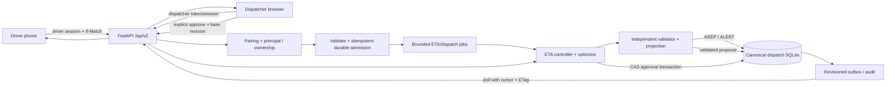

# Dispatch/controller/mobile backend audit and handoff

**Status:** proposed design artifact, not an implemented API. Audit scope: dispatch/demo/auth/ETA controller/jobs/store/validator and frontend API. Repository: `silver-computing-machine/` at HEAD `2c7a4fb809c58a9ec02b6cf2d7b9a8a8bacb1c95`, clean before audit. Checked 2026-10-30 Asia/Calcutta. `trainingv3/` was preserved and not inspected or modified. No implementation files changed.

## C. Verified capability and ownership inventory

| Capability | Classification | Evidence and limit |
|---|---|---|
| Domain scenario/route solve | Verified implemented | `backend/domain.py` validates a bounded static scenario and exact solver produces vehicle routes; all times are abstract time units. |
| Independent route validator | Verified implemented | `backend/validator.py:16-120` reconstructs coverage, capacity, timing, penalties, objective from submitted scenario; it is independent of route generation. It has no identity, version, persistence, or dispatch policy. |
| Demo road route catalog | Verified implemented | `backend/demo/routes.py` contains fixed illustrative routes and GeoJSON; duration seconds, distance metres; hardcoded two-vehicle demo, not computed from ETA/domain solver. |
| Demo coordination | Verified implemented but not HTTP/runtime-verified | `backend/demo/service.py:21-241` seeds demo state, scores route catalog under synthetic overlays, performs KEEP or publishes the best route for that same vehicle when it saves >=120 seconds and >=10%. `base_route_version` is accepted but unused. No validator call. |
| Demo pairing/session primitives | Partially implemented | `backend/demo/auth.py:19-65`, `store.py:58-74,126-181` support one-use codes, bearer-like opaque tokens, expiry checking, revocation. Not exposed over HTTP, no expiry on pairing codes, no session/token ownership checks integrated with a route, plaintext token at rest, and there is no auth role/session binding for dispatcher operations. |
| Demo persistence | Partially implemented | `backend/demo/store.py:25-323` owns `demo_store.sqlite3`, stores state/reports/jobs/audit. Report, job, decision, route publication, and audit are separate commits; request/event uniqueness isn't bound to driver and report uses `INSERT OR REPLACE`. No single transaction protects publication plus provenance. |
| ETA registration/events/proposals/approval/manifests | Verified implemented in source; local tests partially executed (see L) | `backend/india_eta/controller.py:109+`, `store.py:21-106`, `api.py:17-142`. SQLite `eta_*` tables live in the configured ETA DB. Only ETA controller publishes plan versions/manifests, with a guarded approval transaction. Demo store is separate. |
| ETA jobs | Verified implemented in source; runtime evidence partial | `backend/india_eta/jobs.py:26-184` bounded durable async event jobs, idempotent event IDs, two workers max, 10s default deadline, input/output caps, cancellation suppression, restart-interrupted records. Worker thread is not forcibly killable. |
| ETA HTTP auth | Verified implemented | `backend/auth.py:28-194` optional dispatcher/researcher/admin token roles; fails closed when token config is malformed. No driver principal or resource-owner policy. `/api/v1/eta` route policy explicitly restricts writes to dispatcher/admin. |
| Demo HTTP API | Absent | No FastAPI router for `backend/demo`; repository search finds the demo service used only by unit tests. `backend/api.py:579-581` mounts only `backend.india_eta.api` for ETA, plus its scenario/job APIs. |
| Existing frontend API | Verified implemented, but does not cover dispatch/demo | `frontend/src/api/endpoints.ts` only wraps `/api/v1` scenario, plan, job, recovery, risk and QAOA endpoints; no demo/ETA methods, no bearer/session handling, no polling cursor or ETag logic. |
| Single dispatch authority / sync feed / outbox | Absent | Demo and ETA stores have unrelated state and route versions. No publication outbox, global revision, event cursor, or cross-store transaction. |

### Structural finding

The demo's `driver_state.route_version` and `manifest_revision` (`backend/demo/store.py:77-88`) are not ETA `eta_plans.version` nor `eta_manifests.version`. The same-vehicle demo decision directly calls `DemoStore.update_driver_route` (`service.py:204-217`) while ETA approval creates the canonical active version and every vehicle manifest in a `BEGIN IMMEDIATE` transaction (`india_eta/store.py:94-104`; `controller.py:356-477`). A UI could therefore show a demo route as published while the controller still serves a different plan. Do not mirror or reconcile those counters heuristically.

## D. P0 vertical slice and architecture



**Ownership decision:** `EtaController`/`EtaStore` become the only writer and source of truth for active plan version, route assignment and driver manifest. Existing ETA approval remains the gate: static validation, completed-prefix preservation, scenario re-projection and cost/hysteresis recomputation occur before one atomic compare-and-swap. `DemoCoordinatorService` may contribute only a candidate generator/scorer for the fixed synthetic road catalog; remove its direct publication authority. D1 extends the existing `EtaStore` and its transaction API with namespaced dispatch tables; do not create a second authoritative `DispatchStore` or SQLite database. A second sqlite database cannot atomically commit the active plan and feed. No client sends arbitrary actor/role/driver/vehicle assignment.

**First vertical slice:** one local backend process, configured SQLite path, explicit `DEBUGLEAF_AUTH_MODE=token` for dispatcher/admin actions, seeded synthetic initial plan + driver pairing code, two phones and dispatcher browser. Driver pairs once, fetches own manifest and revision; reports one congestion event with idempotency key and base revision; server validates ownership/freshness and stores admission/job; bounded worker returns KEEP/ALERT or a candidate proposal after independent validation; dispatcher reads proposal and approves with `If-Match` plus base version/context hash; controller transaction creates the next authoritative plan version, all vehicle manifests and audit/outbox rows atomically; phones and browser poll from cursor and reconcile latest manifest. On any failure retain the last committed version and expose a stable terminal job error.

### Per-transition contract table

| Transition / owner | Input -> output; unit | State and transaction / idempotency | Principal | Failure and durable rule |
|---|---|---|---|---|
| Pair driver / new `DispatchAuth` router+store | Pair code -> opaque access token, `driver_id`, `vehicle_id`, expiry; expiry UTC timestamp | One `BEGIN IMMEDIATE`: consume unexpired, unused code and insert hashed session with immutable driver/vehicle scope. Idempotency: code single-use; duplicate returns generic 401/409, never mints second session. | Unauthenticated pairing; pairing code server seeded | Invalid/expired/replayed code -> same generic 401. Store only token hash, code expiry and consumed timestamp. Rate limit. |
| Read snapshot / new `dispatch_api.py` | Session -> `{driver, manifest, revision, cursor, server_time}`; route duration seconds, distance metres, ETA/solver times minutes where explicitly named | Read own canonical manifest and feed snapshot in one read transaction. GET idempotent; ETag from monotonic `dispatch_revision` and manifest version. | Own driver session; dispatcher/admin may request fleet snapshot | 401 expired/revoked, 403/404 cross-owner (prefer indistinguishable 404). Must never read from stale demo route table. |
| Admit event / API + event table | `{event_id, expected_plan_version, expected_manifest_revision, occurred_at, type, segment_id, severity}` -> `202 {event_id, job_id, status:queued, cursor}` | Validate token vehicle ownership, body, allowed segment, size, rate, base version. One transaction records unique `(principal_id,event_id)` raw normalized payload hash + queued job + outbox revision. Same key/content returns existing job; same key/different hash -> 409. | Own driver or authorized dispatcher | Persist accepted event before 202; over-limit 413/429; stale version 409; DB error 503 and no accepted response. Never store raw note without length cap/scrubbing. |
| Evaluate / job worker + controller | Admitted event, active plan snapshot, observed state -> `KEEP|ALERT|PROPOSE_REPLAN`, projections, proposal ref; durations minutes, money currency-declared | Existing `EtaJobs`/controller reserves event and rejects duplicate changed payload; transaction seals event context and invalidates pending proposal; optimize outside write tx; recheck context hash/base version before persisting result/proposal. | System worker with source event principal recorded | Timeout/cancel/restart -> durable terminal `timed_out|cancelled|failed`, no proposal/plan publication. Late result discarded. Last approved plan unchanged. |
| Validate proposal / `validator.py` + `projection.py` | Candidate + frozen source scenario + joint worlds + observed vehicle state -> independent static and remaining-state validation, same-world cost delta | No publication. Persist validator output separately from raw solver candidate and all repairs/fallback. Candidate IDs deterministic over job/context/content or server UUID; proposal bound to base version/context hash/expiry. | System worker | Any route/coverage/capacity/prefix/hard-window/cost mismatch -> validation failure; no approved state. Current validator has generic objective units; controller evaluator currency/rate is caller-supplied proxy. |
| Read proposal / API | proposal ID -> proposal, status, base version, expiry, context hash, validated candidate/cost | Read-only; ETag over proposal status + current plan revision. | Dispatcher/admin; researcher only if separate read-only operational data policy explicitly permits | 404 for not found/unauthorized. No driver's ability to approve. |
| Approve / existing `EtaController.approve_proposal` | `{base_version,event_id,model_version,context_hash}` + `If-Match` -> new `plan_version`, manifests, validation, `dispatch_revision` | One SQLite `BEGIN IMMEDIATE` compare-and-swap: authenticated role, pending/expiry/job success, active base version, event/context/model, independent validation, monotone completed prefix, hard windows and recomputed keep/candidate benefit/hysteresis, no vehicle conflict; insert active plan, manifests (revoke removed vehicles), audit and outbox/cursor; mark proposal approved. Idempotency: proposal can transition only pending->approved once. | Dispatcher/admin only | Stale/racing approval -> 409; validation -> 422/409; storage failure -> rollback every write. Exactly one racing approver wins; no partial new route. |
| Sync/ack / API + outbox | cursor/ETag + client known revision -> diff or reset snapshot; `ack_revision` | Atomic reads against revision. Ack is monotonic max and owned manifest version; repeated ack same revision no-op. Feed cursor monotonic sequence, never wall-clock-only. | Own driver; dispatcher/admin fleet | Cursor expired/unknown -> `410 reset_required` + current snapshot; offline client re-fetches snapshot, replaces local state only with higher revision; duplicate event retry uses original idempotency key. |

Existing `EtaController` event vocabulary and results are kept (`KEEP`, `ALERT`, `PROPOSE_REPLAN`); no silent conversion of demo `PUBLISHED_NEW_ROUTE` into controller approval. Current ETA route inputs require `position_type=simulated`; live `actual` vehicle state is deliberately unsupported (501). Preserve that boundary in the UI and rehearsal.

### Publication policy

Default hackathon behavior: **explicit dispatcher approval**. It matches existing authorization and the current controller contract. A future opt-in `AUTO_SAME_VEHICLE` policy may auto-call the same approval method only if all are true: fixed assigned vehicle set unchanged; no stop reassignment; every remaining/completed prefix is unchanged; candidate is independently feasible in each declared scenario; recomputed same-world net benefit exceeds switching + hysteresis thresholds; no live/unknown state; policy configuration is server-only; approval actor is an audited `system:auto_same_vehicle` role; compare-and-swap loses on stale context; all normal manifests/audit/outbox write atomically. It must never invoke `DemoStore.update_driver_route` or create a second version. Cross-vehicle/fleet assignment always requires dispatcher approval. No auto path is required for P0.

## G. State, persistence, versioning

Canonical state consists of `(plan_id, plan_version)` immutable history; one active row; versioned per-vehicle manifests; event and job history; proposal status; immutable audit; append-only outbox/feed revision. Use SQLite WAL, foreign keys, parameterized SQL and short `BEGIN IMMEDIATE` writes. Optimization runs outside write transaction. Approval re-reads and validates under the write lock. Store event idempotency by `(principal_id,event_id)` and request digest; expose `Idempotency-Key` header as the same value. Reuse controller context hash to reject stale jobs/approvals.

Every successful canonical mutation increments a single 64-bit monotonic `dispatch_revision` (or use SQLite AUTOINCREMENT outbox sequence). API returns strong quoted ETag, e.g. `"dispatch-42"`, and `revision: 42`; clients use `If-None-Match` for snapshots and `?after=42` for changes. Poll every 1–2 seconds while foreground; exponential backoff 2, 4, 8, 15 seconds with jitter offline, capped at 30 seconds. On 304 keep cache; on 410/reset replace cache with snapshot. Persist last acknowledged revision per driver, never let a client acknowledge another owner's manifest. Reconnect always queries revision, not event time. SSE is optional only after polling is correct; a dropped stream resumes from same cursor and cannot be authority.

Do not derive a driver's route from client-supplied driver ID. Session contains immutable driver and vehicle IDs. Validate both token and canonical manifest ownership on every operation. Keep existing historical versions available for audit, but only latest active manifest can direct the driver.

## H. Proposed mobile/dispatcher API handoff

A static OpenAPI 3.1 proposal is in [`dispatch-openapi.proposed.json`](dispatch-openapi.proposed.json); representative phone, job, proposal, approval and error payloads are in [`dispatch-examples.json`](dispatch-examples.json). Proposed paths use `/api/v2/dispatch`; **none currently exists**. Existing `/api/v1/eta/*` remains unchanged. Use backend mobile-facing DTOs separate from optimizer/internal domain objects.

| Endpoint | Principal | Purpose / result |
|---|---|---|
| `POST /api/v2/dispatch/pairings/redeem` | none + one-time code | Redeem code; `201` driver-scoped token, expiry and own driver identity. Generic `401` on unknown/expired/replayed. |
| `POST /api/v2/dispatch/sessions/revoke` | own driver session | Revoke current token; `204`. |
| `GET /api/v2/dispatch/driver/state` | driver | Current driver assignment, versioned manifest, ordered remaining/completed stops, optional GeoJSON and status. `ETag`, `X-Dispatch-Revision`. |
| `POST /api/v2/dispatch/driver/events/congestion` | driver | Idempotently admit event; `202` with durable job and cursor. Server gets driver/vehicle/base assignment from session/ETag; body cannot choose another vehicle. |
| `POST /api/v2/dispatch/driver/route-evaluations` | driver | Explicitly request evaluation for own route; same job semantics and ownership, no publish. |
| `GET /api/v2/dispatch/jobs/{jobId}` | owner or dispatcher | Durable `queued/running/succeeded/failed/timed_out/cancelled` job status. |
| `GET /api/v2/dispatch/proposals/{proposalId}` | dispatcher/admin | Read proposal and validation/provenance. Driver may see a safe pending status but not approve; disclose only if product requires. |
| `POST /api/v2/dispatch/proposals/{proposalId}/approval` | dispatcher/admin | Approval with `If-Match`, context/base version body. Returns committed version; stale race is `409`. |
| `GET /api/v2/dispatch/dispatcher/snapshot` | dispatcher/admin | Fleet assignments/jobs/proposals, cursor, revision and server time. ETag supports conditional read. |
| `GET /api/v2/dispatch/changes?after={cursor}` | driver or dispatcher | Durable delta feed or reset marker; cursor increments with canonical mutations. |
| `POST /api/v2/dispatch/driver/acknowledgements` | driver | Ack only own current/historical manifest version; monotonic, idempotent. |

The existing `DemoAuthManager` is not safe to expose as-is. Pair code schema needs `expires_at`, `consumed_at`, bounded attempts/rate limiting; redeem under one immediate transaction; use high-entropy random code; store hash of code and hash of session token; constant-time compare where applicable; session scope includes subject, driver, vehicle, created/expiry/revoked; authorization middleware resolves token before route; revoke/logout available; scrub authorization and pairing values from logs. Dispatcher remains `AuthConfig`-controlled server token, never shared with phone. Local app/API remain loopback by default; explicit LAN bind for rehearsal must use host firewall, trusted LAN and configured auth. No client trust of `role`, `driver_id`, `vehicle_id`, `approved`, `route_version`, or model path in body.

Errors use stable envelope `{error:{code,message,details?}, request_id}` with no arbitrary exception values: `invalid_request` 422; `authentication_required` 401; `authorization_denied` 403; `not_found` 404; `stale_revision|idempotency_conflict|proposal_expired|proposal_not_pending` 409; `payload_too_large` 413; `rate_limited|capacity_reached` 429; `unsupported_capability` 501; `storage_unavailable|job_failed` 503. Return `Retry-After` on capacity/rate responses. Do not use 200 for failed jobs.

## K. Security and failure-mode review

| Risk | Current evidence | Required guard |
|---|---|---|
| Cross-driver access | `get_driver_state(driver_id)` trusts caller argument; no demo route/auth middleware exists. `backend/auth.py` says no driver endpoints and maps unknown paths to denied. | Driver routes derive identity/vehicle from server-verified scoped session; service takes principal object, not arbitrary IDs; ownership on read and write, generic unauthorized resource response. |
| Pair replay / expired code | `pairing_codes.is_used` handles replay under process lock, but no expiry/attempt fields; code seeds can replace existing values. | DB uniqueness + one-time UPDATE with expiry condition inside `BEGIN IMMEDIATE`; hashed code, expiry, attempt cap, one session minted, generic error and rate limit. Test concurrent redeem race. |
| Token compromise / lifetime | Opaque random token returned; `sessions.token` stored plaintext; expiry checked on verify only, no persisted cleanup/rotation endpoint. Default TTL 240 min. | Hash bearer token at rest; short configured TTL; expiry/revocation checked on every request; revoke; never log token. |
| Privilege escalation | ETA uses roles from server config, no client role; demo has no HTTP gate; frontend client sends no credentials. | Distinct driver-session and dispatcher principal types; proposal approval only dispatcher/admin; server-only `system:auto_same_vehicle`; no role payload. |
| Divergent route truth | Separate `DemoStore` and `EtaStore`/DB paths; direct demo route update vs atomic ETA approval. | One canonical store/version writer; demo offers candidate only; all publications through controller CAS. |
| Duplicate event / retry | Demo congestion report `INSERT OR REPLACE`; job request lookup is global `request_id`; route request can create `running` without in-flight de-dupe; base version unused. ETA jobs content-hash idempotency is materially stronger. | Unique `(principal,event_id)`, immutable request hash, same hash returns same job, changed hash conflict. Lock base version and event sequence. |
| Race / stale optimization | ETA checks context hash before proposal and approval; demo reads state then evaluates and publishes without base-version CAS. | Keep ETA stale guard and proposal approval transaction; include dispatch feed cursor bump in same transaction. No worker writes directly. |
| Partial persistence | Demo each method commits separately, including report, route, job, audit. | Durable admission transaction, then job result transaction; approval+plan+manifests+audit+outbox all-or-nothing. Last accepted plan survives any failure. |
| DB/resource pressure | ETA caps body 256 KB, result 1 MB, jobs 256, workers 2; demo has no input/body/rate bounds and no history cap. | Apply request bytes, field, note, ID, rate, queue, retained history caps across new routes; expose readiness with store health. |
| Unsafe/error leakage | ETA API sanitizes exceptions; demo `ValueError` embeds unknown driver ID. | Normalize errors; no user data in exception/log; structured audit allowlist; test sentinel redaction. |
| False operational claim | ETA currently admits only `position_type=simulated`; demo route catalog synthetic; current ETA prediction is two-feature synthetic linear fixture. | Return source/mode (`demo_synthetic`), stage, target, units and freshness; label map/time estimates simulated. No live GPS or road travel claim. |
| Network exposure | `frontend/src/api/client.ts` omits credentials and no dispatch auth. | Explicit configured API base URL, TLS/lan allowlist as appropriate, no dispatcher token on phone. CORS narrow; docs/OpenAPI not public in demo LAN; no secrets in browser storage unless session storage is designed and threat-reviewed. |

## L. Verification plan, current evidence, prioritized acceptance

**Executed bounded tests:**

1. `.venv\Scripts\python.exe -m pytest tests\test_demo_service.py -q --tb=long` first ran with platform default temp outside writable roots: 3 failed at `DemoStore` SQLite open; all three also raised teardown permission errors. Cause is sandbox temp path, not demonstrated product behavior.
2. Retried combined bounded run after placing `TEMP` and `TMP` under repo `.runtime`: `tests/test_demo_service.py tests/test_auth.py tests/india_eta/test_controller.py tests/india_eta/test_jobs.py tests/india_eta/test_api.py tests/india_eta/test_api_security.py`; output showed 10 passed before ETA temp database lock errors (`PermissionError WinError 32` removing SQLite file under pytest's configured `.runtime/pytest-tmp-codex`).
3. Retried ETA controller/job/API/security files with a separate `--basetemp=.runtime\dispatch-pytest-temp`; 30 tests passed, then execution produced no further output and was interrupted after about a minute. No final summary/exit success; count is partial only. A warning notes the installed Starlette TestClient/httpx compatibility deprecation.

No tests added. Don't report these partial executions as a clean suite. Re-run in an isolated writable temp root with no concurrent pytest process, one module at a time, and wait for final summaries. Suggested bounded commands:

```powershell
$env:TEMP = (Join-Path (Get-Location) '.runtime\dispatch-test-tmp')
$env:TMP = $env:TEMP
New-Item -ItemType Directory -Force $env:TEMP | Out-Null
.venv\Scripts\python.exe -m pytest tests\test_demo_service.py tests\test_auth.py -q --basetemp=.runtime\dispatch-test-demo
.venv\Scripts\python.exe -m pytest tests\india_eta\test_controller.py -q --basetemp=.runtime\dispatch-test-controller
.venv\Scripts\python.exe -m pytest tests\india_eta\test_jobs.py -q --basetemp=.runtime\dispatch-test-jobs
.venv\Scripts\python.exe -m pytest tests\india_eta\test_api.py tests\india_eta\test_api_security.py -q --basetemp=.runtime\dispatch-test-api
```

### Risk-ranked acceptance checks

| Priority | Gate | Measurable DoD |
|---|---|---|
| P0 | One version authority | Integration test registers v1, generates proposal, approves, restarts backend, reads same v2 plan/manifests from every endpoint; no `demo_store` route can disagree or mutate. |
| P0 | Approval race + rollback | Two concurrent approvals on one proposal: exactly one v2 success, other stable 409; injected failure at manifest/outbox/audit write leaves only v1 active, proposal pending or terminally failed per defined transaction policy, no partial manifest. |
| P0 | Pairing + ownership | One-time code replay (including concurrent requests), expiry, revocation, expired token, token hash at rest, Phone A cannot read/change Phone B, driver cannot approve, dispatcher cannot use driver session. |
| P0 | Retry/order/recovery | Same event key+body returns same job; changed body conflicts; stale manifest version conflicts; out-of-order event rejected; restart marks queued/running interrupted and never publishes late result. |
| P0 | Version sync | ETag 304, monotonic changes cursor, unknown/expired cursor 410 reset, ack never regresses, offline reconnect snapshot converges after dropped notifications. |
| P0 | Independent checks | Candidate and post-approval manifest each pass validator, fixed remaining stops preserved, hard windows met across all declared worlds; raw candidate/fallback/validation separate. |
| P0 | Bounded local runtime | Byte cap, rate cap, worker count 2 max, deadline, queue/history cap, storage busy stable 503, no secret/sentinel in logs/responses. |
| P0 | Units and claims | API field names encode seconds/metres/minutes; scenario optimizer units labeled `scenario_time_unit`; synthetic ETA/road geometry explicitly `demo_synthetic`; no live claim. |
| P1 | Rehearsal | Two distinct phone sessions + dispatcher; all same-plan versions/cursors, one approval, ack, offline/reconnect; no duplicate event or conflicting assignment; evidence capture is only local synthetic. |

## P. Rehearsal script with expected observables

1. Start one backend process bound to loopback, explicitly configured local demo mode and dispatcher/admin auth via private environment; run preflight for DB writable, no competing process lease, route catalog available, worker capacity and API base URL. Bind to trusted LAN only when devices need it; do not print secrets.
2. Reset only namespaced demo/dispatch tables through a reviewed reset command. Seed a version-1 synthetic plan and two short-lived one-time pairing codes with distinct driver/vehicle ownership. Verify canonical database path is shared by API, controller, jobs and feed.
3. Pair Phone A and Phone B. Show distinct driver/vehicle IDs and tokens only on their device; attempt second redemption -> generic rejection. Use A's token to read B's state and expect same 404/403 safe result. Verify dispatcher browser uses its own role token, never either phone token.
4. Load both driver manifests and dispatcher snapshot. Expect one canonical `plan_version`, monotonically increasing manifest revisions, ETag and cursor; GeoJSON is optional and marked synthetic.
5. On Phone A submit a moderate congestion event with idempotency key and base revision. Expect durable `202 queued/running`, job status, then KEEP or ALERT, no changed plan. Repeat identical request -> same event/job; alter body under same key -> 409. Attempt a stale revision -> 409.
6. Submit the deterministic heavy case that produces a feasible alternate. Show proposal with solver output separated from independent validator and same-world cost check; verify active plan and both phones remain v1 pending approval.
7. Dispatcher reviews proposal, submits approval with ETag/base version/context hash. Expect one transaction creating v2 plan, all vehicle manifests including revocation for removed vehicle if relevant, audit and outbox revision. Duplicate/competing approval is 409 and makes no v3. Check invalid/tampered candidate fails validator without changing v1.
8. Both phones poll after cursor, receive v2 manifest and ordered stops, acknowledge v2; dispatcher sees ack and revision. Drop network before the change, approve while Phone A is offline, reconnect A; it fetches current snapshot/reset and converges to v2 without replaying the congestion report.
9. Cancel or force a bounded worker timeout while a newer event supersedes context. Expect durable terminal job error, no late proposal or version publication, last approved v2 preserved.
10. Restart process. Expect v2 plan/manifests/outbox/audit readable; any unfinished job is `restart_interrupted`; active route remains v2. Capture sanitized logs and prove sentinel pairing/token strings are absent.
11. Close server; preserve database/audit and test output paths. Rehearsal passes only if every source is labelled synthetic/demo and neither phone can choose a fleet assignment or claim approval.

## Dispatch-specific implementation work packages and copy-ready prompts

These packages are proposals for the remaining dispatch/mobile bridge; they are not work already executed. Keep model-serving changes in their separate `backend/india_eta/real_prediction.py` / schemas / release modules and don't overlap those files. Do not edit frontend/mobile repositories in this backend handoff.

| Package / owner | Inputs; exact owned files | Dependencies / deliverables | Verification commands | Effort / critical path | Rollback | Definition of done |
|---|---|---|---|---|---|---|
| D1 Canonical dispatch persistence + approval/feed integration / one backend worker | Inputs: existing `EtaController`, `EtaStore`, ETA tests, dispatch schema in this review. Own `backend/india_eta/store.py`, `controller.py`, `jobs.py`, new migration(s) if needed, new `tests/india_eta/test_dispatch_publication.py`. Avoid `backend/api.py`, `backend/demo/*`, model serving files. | Extend same SQLite authority with pairing/session/event/outbox/revision/ack rows; support transactional outbox revision bump in successful `approve_proposal`; preserve previous manifest history; ensure decision/event state uses one canonical data store. Dependencies: none; foundational. | `.venv\Scripts\python.exe -m pytest tests\india_eta\test_controller.py tests\india_eta\test_jobs.py tests\india_eta\test_dispatch_publication.py -q --basetemp=.runtime\dispatch-d1-tests` | L; critical path first, before HTTP bridge. | Keep migration additive and namespaced. Feature-gate new routes; on rollback stop API use but preserve tables/data. Do not copy active versions back to demo DB. | Approval plus manifests, audit, outbox/cursor are all-or-nothing; replay/stale/racing approvals and injected DB failure prove exactly-one publication; restart/recovery and all old ETA tests pass. |
| D2 Mobile/dispatcher router + auth / one backend worker after D1 | Inputs: this OpenAPI + fixtures; existing role token policy. Own new `backend/dispatch/__init__.py`, `backend/dispatch/api.py`, `backend/dispatch/auth.py`, `backend/dispatch/schemas.py`, `tests/dispatch/test_dispatch_api.py`, `tests/dispatch/test_dispatch_security.py`. Avoid `backend/api.py` initially; expose `create_dispatch_router` and a standalone factory. | Pairing redeem, revoke, driver state, event/route-evaluation submit, job/proposal read, approval, dispatcher snapshot, feed cursor, ack. Driver principal from server session; dispatcher/admin token using existing `AuthConfig` config; validators strict/unknown fields denied; redacted bounded stable errors. Depends on D1. | `.venv\Scripts\python.exe -m pytest tests\dispatch -q --basetemp=.runtime\dispatch-d2-tests`; OpenAPI artifact parse/ref check; targeted no-auth/driver-cross-owner/dispatcher-approval tests. | M/L; parallel with D3 only after D1 schema is stable. | Router not mounted by default; feature flag off. Revert new package without changing `/api/v1/eta`. Preserve additive DB tables. | Every OpenAPI path has role, success/error mapping; pair replay/expiry/ownership verified; no route lets client set driver/vehicle/role/approval; 304/409/410 semantics tested. |
| D3 Safe demo adapter / one backend worker after D1 | Inputs: `DemoCoordinatorService` and fixed `RouteCatalog`. Own new `backend/dispatch/demo_adapter.py`, new adapter tests. Avoid `backend/demo/store.py` publication paths and avoid editing shared ETA controller. | Convert catalog choices into candidate context/provenance only; no `DemoStore.update_driver_route`; route geometry can attach only to approved manifest as optional immutable metadata; use same route candidate -> independent validation -> proposal -> dispatcher approval flow. Depends on D1. | `.venv\Scripts\python.exe -m pytest tests\dispatch\test_demo_adapter.py tests\india_eta\test_controller.py -q --basetemp=.runtime\dispatch-d3-tests` | M; after D1; may run parallel with D2 if interface is fixed. | Disable adapter feature flag; existing `/api/v1/eta` remains unchanged. Never migrate or delete demo records. | Same-vehicle candidate can become proposal; no auto direct publication; controller is sole active route version authority; geometry and scores marked synthetic; no unmatched unit conversion. |
| D4 App composition / integrator | Inputs: complete D1-D3 modules and tests. Own only `backend/api.py` integration lines and `tests/dispatch/test_app_composition.py`; coordinate with model API owner before any shared edit. | Mount dispatch router under `/api/v2/dispatch` with server-configured SQLite path and lifecycle; share AuthConfig safely; preserve existing v1 endpoints/body limit; readiness includes store/worker state. | `.venv\Scripts\python.exe -m pytest tests\dispatch tests\india_eta\test_api.py tests\india_eta\test_api_security.py -q --basetemp=.runtime\dispatch-d4-tests` | S/M; critical path last after router contract. | Router registration behind disabled config flag; revert mount only. Do not touch runtime DB outside reviewed migration. | App factory mounts exactly once; old API smoke/tests remain valid; auth matrix, path size limit, startup/readiness, one-process DB lease pass. |
| D5 Demo-only reset and rehearsal support / one backend worker | Inputs: reset boundary and P script above. Own `tools/reset_dispatch_demo.py`, `tools/dispatch_preflight.py`, tests under `tests/dispatch`. | Guard destructive reset to namespaced demo tables only; require admin action/explicit `--demo-only`; preserve approved plan, ETA model, experiment/model artifacts; print no secrets. Provide deterministic fixture seed and local rehearsal preflight. Depends on D1-D4. | `.venv\Scripts\python.exe -m pytest tests\dispatch\test_reset.py tests\dispatch\test_preflight.py -q --basetemp=.runtime\dispatch-d5-tests`; run preflight on disposable DB. | S/M; after API works, not critical to first API vertical slice. | Reset tool never auto-runs; remove tool if boundary tests fail; keep DB backup. | Test proves ETA plan/history/model tables remain byte-equivalent while only demo pairing/events/jobs/ack rows reset; seeded pair codes are expiring and non-secret. |

### Copy-ready backend worker prompts

**D1 prompt — canonical store and publication**

> Implement D1 only from `architecture-review/dispatch-review.md` and `dispatch-openapi.proposed.json`. Preserve existing `/api/v1/eta` semantics. Make the ETA controller/store the single active plan and driver-manifest version authority. Add namespaced pairing/session/outbox/cursor/ack persistence to the same configured SQLite DB/transaction boundary, and ensure atomic approval commits plan version, all manifests/revocations, audit, proposal decision and outbox revision. Keep candidate work outside the transaction; re-check context/version under `BEGIN IMMEDIATE`. Add focused tests for same-content retry, changed-content conflict, concurrent approval exactly-one-wins, stale revision, injected rollback, feed monotonicity, and restart. Own only `backend/india_eta/store.py`, `controller.py`, `jobs.py` and new `tests/india_eta/test_dispatch_publication.py`. Do not touch `backend/api.py`, `backend/demo/*`, any model release/prediction module, UI, model artifacts or training. Use local bounded tests, no training/cloud calls, no commit. Report exact commands and results; no claim of complete suite unless command exits zero.

**D2 prompt — versioned HTTP contract and scoped auth**

> Implement D2 against `architecture-review/dispatch-openapi.proposed.json` and `dispatch-examples.json` as static proposed contracts; paths are proposals. Add only `backend/dispatch/{__init__.py,api.py,auth.py,schemas.py}` and `tests/dispatch/`. Expose strict `/api/v2/dispatch` router factory but do not mount it. Implement one-time expiring pairing redemption and revocable driver-scoped sessions; driver ID/vehicle always come from server session. Dispatcher/admin approval uses server-configured role auth. Reject unknown fields, bodies over configured cap, non-finite values, stale If-Match, changed idempotency payload and cross-driver IDs; sanitize errors/logs. Implement HTTP 202 durable event/job operations, dispatcher proposal/snapshot, approval delegation to existing controller, GET ETag/304, monotonic changes cursor/410 reset, own-manifest ack. Keep all writes in D1 store API; no new authoritative route tables and no direct demo publication. Do not edit `backend/api.py`, ETA controller/store, model modules, frontend, or training/artifacts. Add API/security tests for every permission boundary and documented success/error statuses; no new external dependencies unless unavoidable. Stop if D1 interface is missing and document exact interface needed.

**D3 prompt — demo candidate adapter only**

> Implement D3 only. Reuse `backend/demo/routes.py` catalog as an explicitly synthetic candidate/geometry source. Add new `backend/dispatch/demo_adapter.py` and `tests/dispatch/test_demo_adapter.py`; do not modify `backend/demo/store.py`, `backend/demo/service.py`, `backend/india_eta/controller.py`, API composition, model modules or artifacts. Convert demo score/candidate results into the ETA/controller candidate/proposal path, preserve ordered remaining stops and same assigned vehicle, and call the independent validator. No direct route write, no hidden approval, no fleet assignment, no conversion from seconds/metres into ETA minutes unless named and tested. Add fixture tests proving old path is never publication authority and source labels survive into proposal/manifest.

**D4 prompt — app composition**

> Integrate the completed dispatch router under `/api/v2/dispatch` in `backend/api.py` only after D1-D3 module APIs are merged/stable. Coordinate first with the model-serving owner so edits to `backend/api.py` do not overwrite inference routes. Share the current app's auth config and ETA DB path; mount once, preserve `/api/v1`, middleware/body cap, lifespan and local loopback default. Add `tests/dispatch/test_app_composition.py`; run bounded old API/security plus dispatch tests. Do not edit dispatch internals, model internals, UI or artifacts. Feature-disable router by default if configuration is incomplete. Provide no claim that HTTP paths are live until TestClient exercises actual mounted routes.

**D5 prompt — scoped reset/preflight**

> Implement demo-only reset and preflight after dispatch API works. Own only new `tools/reset_dispatch_demo.py`, `tools/dispatch_preflight.py`, and dispatch tests. Reset must transactionally delete only explicitly enumerated demo-scoped pairing/session/event/job/ack/overlay records after an explicit admin/CLI guard. It must preserve active approved plan versions, ETA events/proposals/manifests/audit, model releases, datasets, training evidence and non-demo jobs. Add a disposable-SQLite test that hashes preserved tables before/after and proves no secret or token printed. Do not edit API/controller/store ownership, do not run against a user database by default, and do not auto-run reset at startup.

## Evidence anchors

- Demo routes absent from the mounted app: `backend/api.py:117-149,579-581`; current ETA router definitions: `backend/india_eta/api.py:17-142`.
- Demo direct publication and threshold: `backend/demo/service.py:102-169,171-231`; no caller `base_route_version` recheck is present in the method body.
- Demo identity/session/database: `backend/demo/auth.py:19-65`; `backend/demo/store.py:58-181`; direct route write: `store.py:203-218`; replay-prone report upsert `store.py:235-253`; globally keyed planning job `store.py:273-293`.
- Canonical ETA approval: `backend/india_eta/controller.py:356-477`; atomic store `backend/india_eta/store.py:94-104`; manifest writer `controller.py:690-743`.
- ETA event admission/context guard: `backend/india_eta/controller.py:168-270`; bounded job limits/duplicate/hash/restart/cancel: `backend/india_eta/jobs.py:26-184`.
- Role policy/no driver routes: `backend/auth.py:78-160`; mounted ETA router uses configured server auth for plan registration and approval at `backend/india_eta/api.py:45-57,83-141`.
- Independent plan recomputation: `backend/validator.py:16-120`.
- Frontend only maps existing v1 routes and omits Authorization headers: `frontend/src/api/endpoints.ts`; generic fetch wrapper `frontend/src/api/client.ts:27-82`.


## Source-reading ledger and reconciliation

The audit read and reconciled these local sources before proposing the new contract:

| Source | Use in this review |
|---|---|
| `AGENTS.md`, `README.md`, `docs/V1-ACCEPTANCE.md`, `docs/API-RUNTIME.md` | Current V1 scope, role safety, demo loopback/runtime claims and reported evidence; acceptance targets remain distinct from executed results. |
| `sources/problem-extract.txt` | QML-01 asks for an exact vehicle-to-route plan, ordered stops, ETA/risk and financial exposure; rubric expects genuine QpiAI QCloud + QpiAI Opt execution evidence. This supports strict source labels and not claiming the fixed road catalog is live dispatch. |
| `docs/ARCHITECTURE.md` | Modular monolith, strict HTTP boundary, bounded concurrency, independent validator and local SQLite patterns. It predates the added ETA controller and demo code, so it is not treated as proof those components share state. |
| `docs/HACKATHON_INTEGRATION_PLAN.md` | Planned two-phone flow, own-driver snapshots, idempotent events, revision polling/acknowledgement, dispatcher approval fallback, and narrow same-vehicle auto policy. These remain proposed acceptance/design items where no mounted API exists. |
| `docs/INDIA-ETA-CONTRACTS.md`, `docs/INDIA-ETA-CONTROLLER.md`, `docs/INDIA-ETA-INTEGRATION-PLAN.md` | Existing `/api/v1/eta` schema, event/job lifecycles, proposal context hashes, approval checks, manifest revisions, roles and run bounds. Plan text is older than current implementation; code + integration report determine current status. |
| `docs/INDIA_ETA_FEATURE_AVAILABILITY_AUDIT.md` | Feature availability and strict boundary between synthetic two-feature fixture and 59-feature model-ready rows; actual/preparation-time data may be post-pickup. No driver bridge is implied. |
| `INDIA_ETA_INTEGRATION_REPORT.md` | Reconciles current controller implementation and executed 107+10 focused / 120+18 regression / 69-request localhost evidence. It explicitly says there is no driver auth/client/acknowledgement/tenant isolation; use it to distinguish verified controller behavior from proposed mobile contract. |

The OpenAPI and JSON fixtures were statically checked after the quantum review feedback. The cursor-reset example now conforms to `DriverState`; all local `$ref`s resolve (115 occurrences); five representative schema fixtures validate. No live endpoint call was made against proposed `/api/v2/dispatch` routes.
