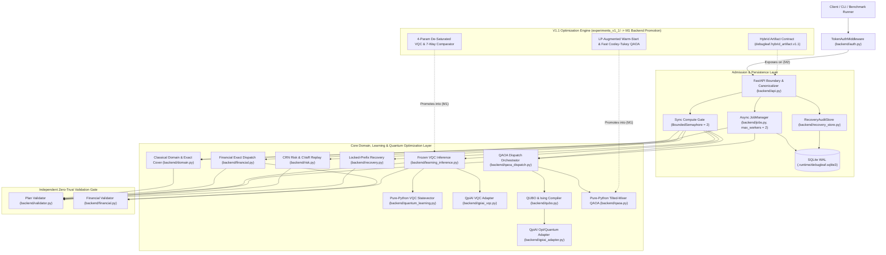

# System Architecture — ArQ

> **Project Name:** **ArQ**  
> **Architectural Style:** Layered Modular Monolith with Zero-Trust Validation Gates & Isolated Quantum Adapter Ports  
> **Source of Truth:** Derived directly from `backend/` (19 modules), `experiments_v1_1/` (5 modules), and `docs/API-RUNTIME.md`.

---

## 1. High-Level System Overview

ArQ is structured as a **single-process, loopback-bound FastAPI backend** (`backend/api.py`) backed by **dependency-free pure-Python domain, optimization, and quantum simulation engines** plus **WAL-mode SQLite persistence** (`.runtime/debugleaf.sqlite3`).

The architecture enforces three strict structural invariants:
1. **Boundary Sanitization & Admission Control:** Every HTTP request passes optional constant-time RBAC (`backend/auth.py`), strict whitelist canonicalization (rejecting unknown fields and never echoing input values in error responses), and bounded concurrency gates (`BoundedSemaphore(2)` for synchronous compute; `ThreadPoolExecutor(max_workers=2)` for durable async jobs).
2. **Algorithmic Independence from Vendor SDKs:** All core classical solvers, 2-qubit/4-parameter VQC statevector simulators, parameter-shift gradient rules, QUBO/Ising compilers, and tilted-mixer QAOA engines run in pure Python (`math`, `cmath`, `itertools`, `random`). External vendor libraries (`qpiai_opt`, `qpiai_quantum`, and planned `ortools`) are isolated behind leaf adapter modules that fail closed (`SDK_NOT_INSTALLED` / `unsupported_capability`) without silently substituting another backend.
3. **Zero-Trust Validation Gate:** Every route-selection path—classical exact search, monetary exact search, VQC risk-adjusted selection, QAOA bitstring decoding, risk scenario replay, and disruption recovery—must pass `backend/validator.validate_plan` (and `backend/financial.validate_financial_plan` when monetary terms apply) before any plan is persisted or returned to a client.

---

## 2. System Diagram (Mermaid)



---

## 3. Components & Module Responsibilities

| Layer | Module | Responsibility |
| :--- | :--- | :--- |
| **HTTP & Auth Boundary** | `backend/api.py` | Versioned `/api/v1/*` FastAPI router, strict key whitelist canonicalizer (`_canonical_scenario`, `_canonical_validated_plan`), non-echoing 422 error mapper, 2-slot synchronous compute gate, and HTTP status translation (`200`, `202`, `401`, `403`, `404`, `409`, `422`, `429`, `500`, `503`). |
| | `backend/auth.py` | `AuthConfig` and `TokenAuthMiddleware`. Supports `local` (no-auth loopback) and `token` RBAC (`dispatcher`, `researcher`, `admin`) via `hmac.compare_digest`; fails closed (`503 auth_misconfigured`) on missing/duplicate tokens. |
| **Persistence & Concurrency** | `backend/jobs.py` | `JobManager` managing `ThreadPoolExecutor(max_workers=2)`, `jobs` and `runtime_lock` SQLite tables, PID liveness lease, 30s deadline enforcement, cancellation suppression, SHA-256 request hashing, and `restart_interrupted` startup recovery. |
| | `backend/recovery_store.py` | `RecoveryAuditStore` managing append-only `recovery_audits` SQLite records keyed by `scope_sha256` so failed disruption recoveries never overwrite a scope's last validated recovery plan. |
| **Core Classical Domain & Validation** | `backend/domain.py` | Scenario validator (`validate_scenario`), capacity-prefix-pruned route generator (`generate_routes`), and deterministic exact-cover solver (`solve_exact`, capped at `8` orders, `16` vehicles, `10,000` routes, `100,000` work units). |
| | `backend/validator.py` | Zero-trust `validate_plan(scenario, plan)` recomputing stop order, load capacity, arrival/service/departure clocks, `hard_window` deadlines, lateness penalties, and total objective from raw scenario dictionaries. |
| | `backend/financial.py` | `solve_financial_dispatch` and `validate_financial_plan` computing caller-declared currency operating + SLA exposure totals ($\le 6$ orders, $\le 8$ vehicles, $\le 5,000$ work units) alongside proxy validation. |
| **Quantum Learning (VQC)** | `backend/quantum_learning.py` | Exact 2-qubit statevector simulator (`RY(pi*x0)`, `RY(pi*x1)`, `CNOT(0,1)`, `RY(theta0)`, `RY(theta1)`, `CNOT(1,0)`), `<Z0>` expectation, parameter-shift gradients, and toy softmin decision loss. |
| | `backend/prospective_dispatch.py` | Leakage-safe synthetic scenario generator, forecast-vs-realized split protocol, route feature extractor (`forecast` travel + `nominal` window pressure), and prospective VQC/logistic trainer. |
| | `backend/learning_inference.py` | Synchronous frozen VQC inference (`predict_dispatch`) for $\le 3$ orders / $\le 4$ vehicles / $\le 20$ routes, supporting `reference` and `qpiai_local` backends, `hard_window`, `financial_terms`, and explicit classical fallback. |
| **Quantum Optimization (QUBO / QAOA)** | `backend/qubo.py` | `Qubo` dataclass, `build_route_qubo` (exact-cover + per-vehicle penalties), `qubo_to_ising` (exact offset-preserving $z \in \{-1, +1\}^n$ transform), `enumerate_qubo`, and `validate_selection`. |
| | `backend/qaoa.py` | Pure-Python statevector QAOA (`run_qaoa`), continuous relaxation, tilted warm-start state preparation $\bigotimes_i (\sqrt{1-p_i}|0\rangle + \sqrt{p_i}|1\rangle)$, tilted XY/Z mixer evolution, angle-grid search, and greedy bitstring repair tracker. |
| | `backend/qaoa_dispatch.py` | Connects `generate_routes` $\to$ `build_route_qubo` $\to$ `run_qaoa` $\to$ `validate_plan` ($\le 12$ route variables), accepting only domain-valid raw quantum samples and labeling classical fallbacks explicitly. |
| **Operational Risk & Recovery** | `backend/risk.py` | `evaluate_plan_risk` replaying a fixed validated plan across $1\text{–}100$ CRN travel matrices, computing empirical late-stop/order frequencies, expected costs, and fractional-tail $\text{CVaR}_\alpha$. |
| | `backend/recovery.py` | `recover_dispatch` performing static depot-replay re-optimization ($\le 2,000$ routes, $\le 10,000$ nodes) under updated travel times or vehicle removals while locking committed route prefixes. |
| **Vendor SDK Adapters** | `backend/qpiai_vqc.py` | Executes the 2-qubit VQC on `qpiai_quantum.simulator.StatevectorSimulator` without cloud calls. |
| | `backend/qpiai_adapter.py` | Compiles `Qubo` into `qpiai_opt.opt_modeller.Model` / `QUBOProblem`, verifies $2^n$ energy equivalence ($\le 8$ vars), builds `WarmStart` + `QAOA(reps=1)`, and samples via QpiAI `StatevectorSimulator`. |
| **V1.1 Research & Contract Engine** | `experiments_v1_1/*` | Primal-Dual Augmented-Lagrangian LP relaxation (`lp_augmented_relaxation`), Cooley-Tukey $O(n 2^n)$ QAOA evolution (`fast_qaoa_state`, `p=1,2`), 4-param affine-readout VQC, Newton GBDT comparator, exhaustive 12-qubit verifier, and `HybridDispatchArtifact` (`debugleaf.hybrid_artifact.v1.1`). |

---

## 4. Inter-Component Communication

- **In-Process Synchronous Calls:** `backend/api.py` calls domain, inference, QAOA, financial, risk, and recovery functions directly via typed Python dictionaries and dataclasses. Domain modules raise typed exceptions (`SolveBudgetExceeded`, `InferenceError`, `FinancialError`, `RiskError`, `RecoveryError`, `JobCapacityError`) carrying machine-readable `code` strings; `api.py` maps these to deterministic HTTP status codes without leaking stack traces or input values.
- **Bounded Thread-Pool Asynchronous Jobs:** `POST /api/v1/jobs` and `POST /api/v1/jobs/qaoa` submit closures to `JobManager._executor` (`ThreadPoolExecutor`). State transitions (`queued` $\to$ `running` $\to$ `succeeded | infeasible | failed | cancelled`) are coordinated via `threading.RLock` + SQLite transactions so HTTP polling (`GET /api/v1/jobs/{id}`) reads committed state safely across threads.
- **Cross-Team / Cross-Machine Artifact Handoff:** Training/benchmark engines exchange frozen model weights, calibration scores, route dollar coefficients, and QUBO matrices via canonical JSON documents validated by `experiments_v1_1/artifact_contract.py` (`artifact_sha256`).

---

## 5. Data Flows for Primary User Flows

### 5.1 Synchronous VQC Risk-Adjusted Dispatch (`POST /api/v1/scenarios/vqc-plan`)
```text
HTTP JSON {forecast_scenario, nominal_scenario, theta, model_version, execution_backend, financial_terms?}
  │
  ├─► TokenAuthMiddleware: verify local mode OR constant-time Bearer token role ∈ {researcher, dispatcher, admin}
  ├─► api.py: verify exact top-level keys & acquire compute_slots (else 429 capacity_reached)
  ├─► learning_inference.predict_dispatch():
  │     ├─► Validate identical depot/vehicles/orders & matching hard_window flags (≤3 orders, ≤4 vehicles)
  │     ├─► domain.generate_routes(forecast_scenario) -> ≤20 capacity/hard-window feasible routes
  │     ├─► Compute features x_r = (min(forecast_travel/30, 1), nominal_window_pressure) per route
  │     ├─► Backend branch:
  │     │     ├─ "reference"   -> quantum_learning.risk_probability(x_r, theta)
  │     │     └─ "qpiai_local" -> qpiai_vqc.sdk_risk_probability(x_r, theta) [no silent fallback!]
  │     ├─► Score routes (proxy minutes OR explicit currency + 1-min expected SLA penalty)
  │     ├─► Enumerate ≤500 exact covers -> pick minimum estimated-cost plan
  │     └─► validator.validate_plan(forecast_scenario, plan) [+ financial.validate_financial_plan if requested]
  └─► Return HTTP 200 {plan, route_predictions, model_provenance, validation, financial_validation?}
```

### 5.2 Asynchronous Warm-Start QAOA Job (`POST /api/v1/jobs/qaoa` $\to$ `GET /api/v1/jobs/{id}`)
```text
HTTP POST {scenario, seed, shots, warm_start, angle_grid}
  │
  ├─► api.py: validate scenario + QAOA bounds (≤12 routes, shots ∈ [1,512], grid ∈ [2,10])
  ├─► JobManager.submit_qaoa():
  │     ├─► Enforce active+queued < max_workers (2) under RLock
  │     ├─► Compute canonical request_sha256(scenario + settings)
  │     ├─► INSERT INTO jobs (status='queued', solver='local_qaoa_dispatch', ...)
  │     └─► Submit _run_qaoa(job_id) to ThreadPoolExecutor -> Return HTTP 202 {id, status: 'queued'}
  │
  └─► Worker Thread _run_qaoa(job_id):
        ├─► Check cancellation & deadline_epoch; UPDATE status='running'
        ├─► qaoa_dispatch.solve_qaoa_dispatch():
        │     ├─► domain.generate_routes(scenario) -> build_route_qubo(candidates)
        │     ├─► continuous_relaxation(qubo) -> run_qaoa(qubo, warm_start=True, ...)
        │     ├─► Validate every distinct raw & repaired bitstring via validator.validate_plan()
        │     └─► Select lowest-cost valid RAW sample (else solve_exact with fallback.used=True)
        ├─► Re-verify validate_plan() + check not cancelled/timed-out before commit
        └─► UPDATE jobs SET status='succeeded', result_json=... (polled via GET /api/v1/jobs/{id})
```

### 5.3 Disruption Recovery with Scoped Audit (`POST /api/v1/recovery/plan`)
```text
HTTP POST {original_scenario, original_plan, updated_scenario, locked_prefixes, change_penalty}
  │
  ├─► api.py: canonicalize scenarios & plan; verify validate_plan(original_scenario, original_plan) == valid
  ├─► api.py: prove locked_prefixes[v] == original_route[v][:len(prefix)]
  ├─► recovery.recover_dispatch():
  │     ├─► Verify only travel durations or vehicle removals changed (depot/orders immutable)
  │     ├─► Generate ≤2,000 updated routes; filter to routes starting with locked_prefixes[v]
  │     └─► Exact-cover search (≤10,000 nodes) minimizing validator_objective + change_penalty * reassignments
  ├─► validator.validate_plan(updated_scenario, recovered_plan)
  ├─► RecoveryAuditStore.append(status='recovered'|'failed', scope_sha256=SHA256(orig_scenario, orig_plan))
  └─► Return HTTP 200 {recovered_plan, diff_summary, static_original_baseline, validation, audit}
```

---

## 6. Data Models & Storage Approach

### 6.1 Core JSON Contracts
- **Scenario:** `{depot: str, vehicles: [{id: str, capacity: float}], orders: [{id: str, demand: float, window: [open, close], service: float, penalty: float, hard_window?: bool}], travel: {from_id: {to_id: float}}}`.
- **Plan:** `{status: "feasible" | "infeasible", routes: [{vehicle_id, order_ids, stops: [{order_id, arrival, service_start, departure, lateness, penalty_exposure}], return_time, travel_cost, lateness_exposure, objective}], travel_cost, lateness_exposure, objective}`.
- **Hybrid Artifact (`debugleaf.hybrid_artifact.v1.1`):** 8 mandatory sections (`model_and_dataset_version`, `split_identifiers`, `scenario_and_seed_Provenance`, `risk_predictions_and_calibration`, `candidate_routes_and_coefficients`, `qubo_and_constraints`, `execution_backend_and_config`) sealed by canonical uppercase `artifact_sha256`.

### 6.2 SQLite Schema (`.runtime/debugleaf.sqlite3`, `PRAGMA journal_mode=WAL`)
1. **`runtime_lock`:** `(singleton INTEGER PRIMARY KEY CHECK(singleton=1), pid INTEGER, owner_token TEXT, started_at TEXT)` — single-process lease preventing multi-process corruption; checks OS PID liveness (`ctypes` on Windows, `os.kill(pid, 0)` on POSIX) before recovering interrupted jobs.
2. **`jobs`:** `(id TEXT PRIMARY KEY, status TEXT, scenario_json TEXT, result_json TEXT, error_json TEXT, submitted_at TEXT, started_at TEXT, completed_at TEXT, deadline_epoch REAL, execution_type TEXT, solver TEXT, settings_json TEXT, request_sha256 TEXT, runtime_json TEXT)`.
3. **`recovery_audits`:** `(seq INTEGER PRIMARY KEY AUTOINCREMENT, audit_id TEXT UNIQUE, scope_sha256 TEXT, status TEXT, started_at TEXT, completed_at TEXT, change_penalty REAL, original_scenario_json TEXT, updated_scenario_json TEXT, original_plan_json TEXT, locked_prefixes_json TEXT, result_json TEXT, failure_json TEXT, hashes_json TEXT)` indexed on `(scope_sha256, status, seq)`.

---

## 7. External Services & Integrations

| Integration | Module | Mode in Repo | Boundary & Failure Policy |
| :--- | :--- | :--- | :--- |
| **QpiAI Opt SDK (`0.0.9`)** | `backend/qpiai_adapter.py` | **Local Offline Only** (`Model`, `QUBOProblem`, `WarmStart`, `QAOA`, `build_circuit`) | Never instantiates online `qpiai_opt.Client`; verifies $2^n$ QUBO energies locally ($\le 8$ vars); returns `SDK_NOT_INSTALLED` if absent. |
| **QpiAI Quantum SDK (`0.3.0` / `0.7.5`)** | `backend/qpiai_vqc.py`, `backend/qpiai_adapter.py` | **Local CPU Simulator** (`Circuit`, `StatevectorSimulator`) | Runs exact statevector / shot sampling in-process without API keys; reverses SDK bitstring endianness to match variable order; never silently falls back to reference simulator. |
| **QpiAI QCloud / Indus-1 QPU** | *Not invoked* | **Disabled (`NOT RUN`)** | Out of scope without explicit owner authorization (`AGENTS.md`); zero credentials read or stored in files/logs. |
| **Google OR-Tools (`9.15.6755`)** | `tools/sdk_probes/probe_ortools.py` *(planned `backend/ortools_routes.py` in M3)* | **Local Offline Solver** | Verified 100% offline CP-SAT & `pywrapcp` vehicle-routing library for optional candidate pre-filtering above 8 orders. |

---

## 8. Key Design Decisions & Trade-Offs

| Decision | Chosen Approach | Trade-Off & Rationale |
| :--- | :--- | :--- |
| **D-1: Pure-Python Core vs. Mandatory NumPy/Qiskit** | Pure Python (`math`, `cmath`) for core VQC & QAOA simulators (`backend/quantum_learning.py`, `backend/qaoa.py`, `experiments_v1_1/`). | Limits practical statevector simulation to `4–14` qubits on CPU, but guarantees zero dependency breakage, instant test execution (`< 1s` for 82 core tests), and bit-exact cross-platform reproducibility. |
| **D-2: Zero-Trust Recomputing Validator vs. Shared Helper** | `backend/validator.py` duplicates timing/capacity equations independently instead of calling `domain._route_metrics`. | Slight code duplication (~60 lines), but catches bugs in candidate generation, QUBO decoding, and monetary scaling before any invalid plan can reach a user. |
| **D-3: Raw-Sample QAOA Acceptance vs. Greedy Repair Publication** | `qaoa_dispatch.py` records greedy repairs for diagnostics but only publishes **un-repaired raw samples** as quantum decisions; otherwise triggers explicit `solve_exact` fallback. | Increases fallback rate on weak ansätze (e.g., 83.3% on Standard QAOA), which honestly exposed the warm-start bottleneck and drove V1.1's LP Warm-Start QAOA (`0%` fallback) without faking quantum feasibility via classical post-repair. |
| **D-4: LP Augmented-Lagrangian Relaxation vs. Box Gradient Descent** | V1.1 (`experiments_v1_1/quantum_optimization.py`) solves Set-Partitioning LP without folding $x_i^2 = x_i$ into the objective diagonal. | Eliminates concave penalty-saddle trapping from V1's box relaxation, raising 8-qubit warm-start feasible shot probability from `22.70%` to `60.12%`. |
| **D-5: Publication Suppression on Thread Timeout/Cancel** | `JobManager` marks timed-out/cancelled jobs terminal in SQLite and blocks late writes, while retaining the worker slot until the bounded solve finishes. | Python threads cannot be safely killed preemptively; pairing suppression with strict deterministic work caps (`100,000` exact units, $\le 12$ QAOA qubits) bounds worst-case slot retention to a few seconds without corrupting SQLite. |

